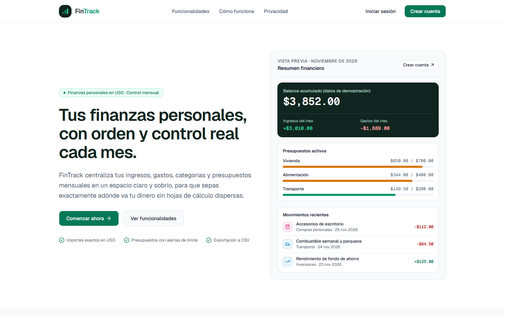
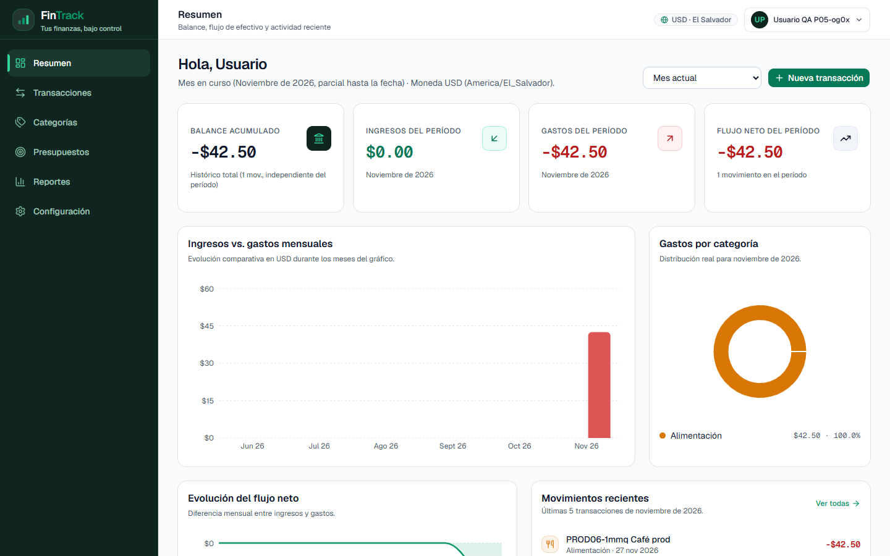

# FinTrack — Tus finanzas, bajo control

Aplicación web SaaS de gestión de finanzas personales en español (`es-SV`), dólares estadounidenses (`USD`) y zona horaria `America/El_Salvador`, construida con **Next.js 16 (App Router)**, **React 19**, **TypeScript estricto**, **Tailwind CSS v4**, **shadcn/ui**, **Recharts** y **Supabase**, desarrollada mediante la metodología **Vibe Coding** (desarrollo iterativo guiado por IA).

## Enlaces de Entrega

- **Aplicación en producción (Vercel):** https://fintrack-ten-weld-84.vercel.app
- **Repositorio público (GitHub):** https://github.com/reneg07/fintrack

> **Estado final:** **Fases 01 a 06 completadas y verificadas en producción** (`15/15` smoke test real sobre `https://fintrack-ten-weld-84.vercel.app`, `36/36` unitarias Vitest, `18/18` RLS, `42/42` seguridad API, `18/18` E2E + `63/63` responsive, `24/24` auditoría y prueba real de `1,005` filas en Supabase, `0` vulnerabilidades en `npm audit`).

---

## Funcionalidades Principales

- **Landing Page (`/`):** Presentación del producto, flujo de uso, pilares de seguridad y vista previa demostrativa claramente etiquetada.
- **Autenticación (`/login`, `/register`, `/auth/callback`):** Sesiones por cookies HTTP con `@supabase/ssr`, protección de rutas mediante `src/proxy.ts` + verificación autoritativa `getUser()` en servidor, formularios React Hook Form + Zod y protección contra open redirects.
- **Resumen Financiero (`/dashboard`):** Balance acumulado histórico independiente del período, KPIs exactos `BigInt` (ADR-011), gráficos interactivos Recharts y 5 movimientos recientes.
- **Transacciones (`/transactions`):** CRUD completo en centavos enteros USD, búsqueda sanitizada con debounce (`300 ms`), filtros combinados (tipo, categoría y rango de fechas), paginación en servidor y totales exactos sobre todo el conjunto filtrado.
- **Categorías (`/categories`):** 12 categorías iniciales sembradas por PostgreSQL + CRUD personalizado con conteo de uso y bloqueo HTTP `409 Conflict` para categorías vinculadas.
- **Presupuestos (`/budgets`):** Límites mensuales exclusivos para categorías de gasto con seguimiento automático en 4 estados (`En control`, `Cerca del límite`, `Límite alcanzado`, `Superado`).
- **Reportes y Exportación CSV (`/reports`):** Comparativas contra período anterior (`Sin base previa` cuando base es `$0.00`), rangos personalizados, tabla mensual exacta y descarga CSV UTF-8 con BOM protegida contra Formula Injection.
- **Configuración (`/settings`):** Edición de perfil sincronizada con el encabezado y cierre de sesión seguro.

## Stack Tecnológico y Arquitectura Resumida

- **Frontend / Framework:** Next.js `16.4.6` (App Router, Turbopack, `src/proxy.ts`), React `19.3.0`, TypeScript `strict`, Tailwind CSS v4, `shadcn/ui` (`@base-ui/react`), `lucide-react`, `recharts`, `sonner`, tipografía `Geist` autoalojada.
- **Formularios y validación:** `react-hook-form`, `zod`, `@hookform/resolvers`.
- **Backend y Datos:** 11 Route Handlers bajo `src/app/api/*` + capa de servicios `server-only` (`src/services/*`) + Supabase PostgreSQL con **Row Level Security (RLS)** forzado y cero uso de `service_role`.
- **Pruebas:** Vitest (`36/36`), Playwright E2E, integración real PostgreSQL/RLS y pruebas de producción.

---

## Instalación y Ejecución Local

### Requisitos previos
- **Node.js** `>= 22.0.0` (desarrollado con `v22.19.0`) y **npm** `>= 10`.
- Proyecto en [Supabase](https://supabase.com/) con las migraciones de [`supabase/phase-03-setup.sql`](./supabase/phase-03-setup.sql) aplicadas.

### Pasos
1. Clona el repositorio e instala dependencias de forma reproducible:
   ```bash
   git clone https://github.com/reneg07/fintrack.git
   cd fintrack
   npm ci
   ```
2. Crea `.env.local` desde `.env.example` y completa tus credenciales públicas de Supabase:
   ```bash
   cp .env.example .env.local
   ```
   Variables requeridas: `NEXT_PUBLIC_SUPABASE_URL`, `NEXT_PUBLIC_SUPABASE_PUBLISHABLE_KEY`, `NEXT_PUBLIC_APP_URL=http://localhost:3000`.
3. Ejecuta el servidor local:
   ```bash
   npm run dev
   ```

### Comandos de Calidad y Pruebas

| Comando | Propósito |
| :--- | :--- |
| `npm run lint` / `npm run typecheck` | ESLint (incluye reglas React 19) y TypeScript estricto |
| `npm run test` | Suite unitaria Vitest (`36` pruebas) |
| `npm run build` | Build de producción con Turbopack |
| `npm run test:supabase-rls` | Integración real PostgreSQL + aislamiento RLS de 2 usuarios (`18` checks) |
| `npm run test:api-security` | Autorización API, CSRF y escenario financiero determinista (`42` checks) |
| `npm run verify:phase04` | E2E financiero completo, descarga CSV y matriz responsive 9×7 (`63` checks) |
| `npm run verify:phase05` | Cobertura 28/28, prueba real de `1,005` filas, accesibilidad, resiliencia y rendimiento |
| `PROD_URL=https://fintrack-ten-weld-84.vercel.app npm run verify:prod` | Smoke test end-to-end contra producción |

---

## Capturas de Producción y Desarrollo

| Landing pública en producción (Vercel) | Dashboard autenticado en producción (Vercel) |
| :---: | :---: |
|  |  |

Más evidencias visuales y grabaciones WebM en [`docs/screenshots/`](./docs/screenshots) y [`docs/recordings/`](./docs/recordings).

## Limitaciones Conocidas

- **Registro público y SMTP personalizado:** `Confirm email` y **RLS** permanecen activos por seguridad (`mailer_autoconfirm: false`). No se configuró un proveedor **Custom SMTP** externo antes de la entrega, por lo que el SMTP integrado gratuito de Supabase restringe el envío de correos de confirmación a miembros autorizados del proyecto (máx. 2/hora). El flujo completo en producción fue verificado con cuenta QA confirmada, y la guía paso a paso para activar Custom SMTP gratuito (Brevo) está documentada en [`docs/DEPLOYMENT.md`](./docs/DEPLOYMENT.md).

## Documentación del Proyecto

- [VIBE_CODING.md](./VIBE_CODING.md) — Bitácora real del desarrollo guiado por IA (Fases 01 a 06).
- [docs/ACADEMIC_REQUIREMENTS.md](./docs/ACADEMIC_REQUIREMENTS.md) — Matriz de cumplimiento de los 21 requisitos académicos.
- [docs/AUDIT.md](./docs/AUDIT.md) — Auditoría técnica y matriz de 28 escenarios E2E.
- [docs/ARCHITECTURE.md](./docs/ARCHITECTURE.md) — Arquitectura, diagramas Mermaid y ADRs (`ADR-001` a `ADR-013`).
- [docs/DEPLOYMENT.md](./docs/DEPLOYMENT.md) — Configuración de despliegue en Vercel, Supabase y estrategia SMTP.
- [docs/TESTING.md](./docs/TESTING.md) — Registro completo de pruebas.
- [docs/walkthroughs/006-deployment-and-delivery.md](./docs/walkthroughs/006-deployment-and-delivery.md) — Walkthrough definitivo de cierre.
