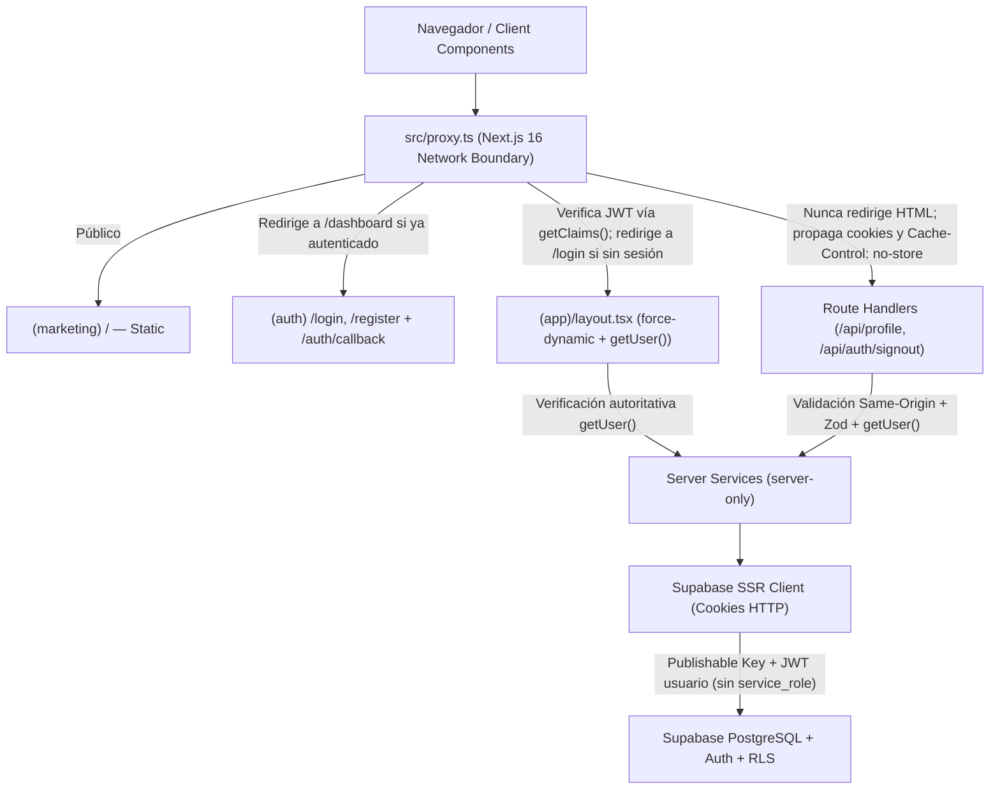
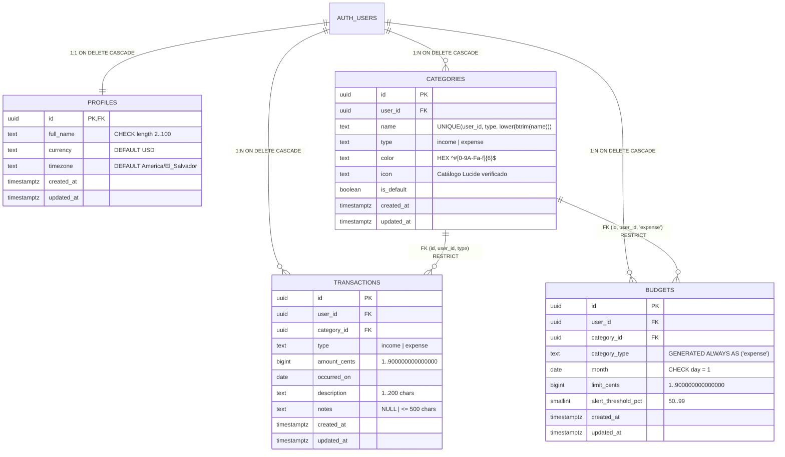

# Arquitectura de Software — FinTrack

> **Estado actual:** Fase 03 implementada y verificada localmente (migraciones PostgreSQL, RLS, tipos `database.ts`, clientes Supabase SSR, `src/proxy.ts`, autenticación real `/login`, `/register`, `/auth/callback`, protección de rutas, APIs `/api/profile` y `/api/auth/signout`, estados vacíos honestos en rutas privadas). Aplicación remota de migraciones y verificación en vivo de RLS pendientes de proyecto Supabase autorizado en `.env.local`.

## 1. Arquitectura de Autenticación y Renderizado (Fase 03)

## 2. Modelo Entidad-Relación en PostgreSQL (Migraciones Versionadas)

## 3. Índices Justificados (`20261126230000_initial_schema.sql`)

| Índice | Tabla y Columnas | Consulta que optimiza |
| :--- | :--- | :--- |
| `idx_categories_unique_name` | `categories (user_id, type, lower(btrim(name)))` | Unicidad de nombre insensible a mayúsculas/espacios por usuario y tipo |
| `idx_categories_user_type` | `categories (user_id, type)` | Listado de categorías separado por ingresos y gastos |
| `idx_transactions_user_occurred_on` | `transactions (user_id, occurred_on DESC, created_at DESC)` | Historial paginado y recientes del dashboard |
| `idx_transactions_user_type_occurred_on` | `transactions (user_id, type, occurred_on DESC)` | Agregaciones de ingresos/gastos por período y cálculo de presupuestos |
| `idx_transactions_category_id` | `transactions (category_id)` | Filtro por categoría y validación rápida de `ON DELETE RESTRICT` |
| `idx_budgets_user_month` | `budgets (user_id, month)` | Consulta mensual de presupuestos en `/budgets` |

## 4. Estrategia de Confirmación por Correo y Redirecciones (`/auth/callback`)

- **Confirmación habilitada (recomendada para producción):** `supabase.auth.signUp` crea el usuario sin sesión activa; `RegisterForm` muestra una pantalla clara de verificación de correo. El enlace enviado apunta a `/auth/callback?next=/dashboard`, donde se intercambia el `code` (PKCE) o `token_hash`+`type` (OTP) por cookies HTTP seguras.
- **Confirmación deshabilitada (opcional en pruebas académicas controladas):** Si el supervisor la desactiva temporalmente en Supabase Auth, `signUp` devuelve sesión activa inmediata y redirige a `/dashboard`. No se desactiva silenciosamente en producción.
- **Prevención de Open Redirects:** `sanitizeNextPath` (`src/lib/redirects.ts`) rechaza URLs absolutas, `//`, `\`, esquemas `http:`/`javascript:` y rutas fuera de los 6 prefijos privados de FinTrack.
- **Configuración en Supabase Dashboard (Auth → URL Configuration):**
  - **Site URL (local):** `http://localhost:3000`
  - **Redirect URLs (local):** `http://localhost:3000/auth/callback`
  - **Configuración futura en Vercel (Fase 06):** Actualizar **Site URL** a `https://<tu-app>.vercel.app` y agregar `https://<tu-app>.vercel.app/auth/callback` en Redirect URLs.

## 5. Registro de Decisiones de Arquitectura (ADR)

- **ADR-001:** Aritmética monetaria exclusivamente en centavos enteros (`BIGINT`, techo `900,000,000,000,000` compatible con `Number.MAX_SAFE_INTEGER`).
- **ADR-002:** Zona horaria determinista `America/El_Salvador` y fechas calendario `DATE`.
- **ADR-003 / ADR-009:** Eliminación de `cacheComponents` y `partialPrefetching` en `next.config.ts` + `export const dynamic = "force-dynamic"` en `(app)/layout.tsx` y `Cache-Control: no-store, private` en Route Handlers, garantizando que nunca se cacheen vistas o respuestas privadas entre usuarios mientras `/` permanece estático.
- **ADR-004:** Actualización limpia de `@types/node@^22` alineada con `Node.js v22.19.0` para compatibilidad sin `--force` con `vitest@5.1.2`.
- **ADR-005:** `shadcn/ui` (`base-nova` sobre `@base-ui/react@1.9.0`) nativo para React 19 y Tailwind CSS v4.
- **ADR-006:** Transición de `demo-data.ts`: restringido exclusivamente a la vista previa claramente etiquetada en `/` y pruebas unitarias; las rutas autenticadas muestran estados vacíos reales y categorías reales de PostgreSQL.
- **ADR-007:** Tipografía `Geist` autoalojada (`geist@1.9.2`) para compilación determinista sin red externa.
- **ADR-008:** Contraste WCAG AA ajustado (`--primary: #047857`, `--danger-text: #B91C1C`, `--warning-text: #B45309`).
- **ADR-010:** Defensa en profundidad en autenticación: `src/proxy.ts` (`getClaims()`) + `(app)/layout.tsx` (`getUser()`) + Route Handlers (`getUser()` + validación `Origin` Same-Origin) + RLS forzado y privilegios mínimos (`REVOKE ALL FROM PUBLIC, anon`) en PostgreSQL.
- **ADR-011 — Estrategia de Seguridad Monetaria Acumulada (Preparación Fase 04):**
  - **Riesgo identificado:** El límite individual por transacción en PostgreSQL y `src/lib/money.ts` es `900,000,000,000,000` centavos (`$9T`, seguro dentro de `Number.MAX_SAFE_INTEGER = 9,007,199,254,740,991`). Sin embargo, la suma de más de 10 registros en ese extremo podría exceder `Number.MAX_SAFE_INTEGER` en JavaScript si se transporta directamente como `number` IEEE-754.
  - **Estrategia obligatoria para Fase 04:**
    1. **Agregaciones exactas en PostgreSQL:** Ejecutar sumas de totales (`SUM(amount_cents)`) en PostgreSQL (donde `SUM(bigint)` devuelve `numeric` de precisión arbitraria sin desbordamiento de 64 bits) o bien acumular en servidor usando `BigInt` sobre cada registro retornado.
    2. **Serialización y transporte seguros:** Al leer totales agregados desde PostgreSQL/PostgREST, validar que cada valor individual o acumulado sea entero exacto y parsear mediante `BigInt` antes de validar contra `MAX_SAFE_CENTS` (o devolver cadena decimal/entera exacta en contratos donde el acumulado supere el límite seguro).
    3. **Formateo sin pérdida de precisión:** Extender `src/lib/money.ts` en Fase 04 con soporte opcional de `bigint` para formateo directo (`bigintCentsToDisplay`) sin pasar por división flotante imprecisa (`cents / 100`) cuando el acumulado sea elevado.
    4. **Validación de límites acumulados:** Mantener el techo individual razonable en esquemas Zod y validar siempre con `Number.isSafeInteger` en bordes de conversión.
- **ADR-012 — Gestión del Historial de Migraciones Aplicadas vía SQL Editor:**
  - **Estado real:** Las migraciones iniciales (`20261126230000_initial_schema.sql` y `20261126230100_rls_and_seed.sql`) se aplicaron manualmente mediante `supabase/phase-03-setup.sql` en el SQL Editor de Supabase (no están registradas en `supabase_migrations.schema_migrations` de Supabase CLI).
  - **Regla de continuidad:** Nunca modificar retroactivamente migraciones ya aplicadas; todo ajuste futuro se agregará como una nueva migración idempotente con timestamp posterior (p. ej. `20261126235000_fix_utf8_seed_and_comments.sql`). Si en el futuro se adopta `supabase db push`, se deberá ejecutar `supabase migration repair --status applied` para los timestamps ya aplicados antes de empujar nuevas migraciones.
