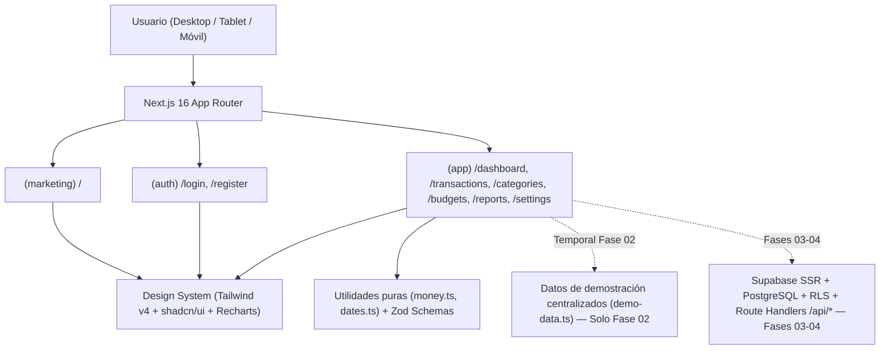

# Arquitectura de Software — FinTrack

> **Estado actual:** Fase 02 (Inicialización, sistema de diseño y vistas preliminares con datos de demostración aislados). La integración real con Supabase PostgreSQL y autenticación corresponde a la Fase 03, y el CRUD/APIs reales a la Fase 04.

## 1. Visión General

**FinTrack** (*Tus finanzas, bajo control*) es una aplicación web SaaS de gestión de finanzas personales construida con **Next.js 16 (App Router)**, **React 19**, **TypeScript estricto**, **Tailwind CSS v4** y **shadcn/ui** (`base-nova` sobre `@base-ui/react`), preparada para operar con **Supabase** (PostgreSQL + Auth + SSR).

## 2. Organización por Route Groups

| Route Group | Rutas | Layout | Estado en Fase 02 |
| :--- | :--- | :--- | :--- |
| `(marketing)` | `/` | Navbar pública + Footer | Implementado y verificado |
| `(auth)` | `/login`, `/register` | Panel dividido con identidad FinTrack + formulario accesible | Interfaz y validación Zod implementadas; autenticación real pendiente (Fase 03) |
| `(app)` | `/dashboard`, `/transactions`, `/categories`, `/budgets`, `/reports`, `/settings` | AppShell responsive (Sidebar 256px desktop, Drawer móvil/tablet, Header) | Interfaz preliminar con datos matemáticos coherentes en `demo-data.ts`; CRUD real y protección de rutas en Fases 03–04 |

## 3. Decisiones de Arquitectura (ADR)

### ADR-001 — Aritmética Monetaria en Centavos Enteros (`src/lib/money.ts`)
- **Decisión:** Representar y operar todos los importes monetarios en centavos enteros (`number` entero validado contra límites seguros de `Number.MAX_SAFE_INTEGER`) y parsear cadenas decimales sin pasar por multiplicación flotante imprecisa (`parseDollarsToCents`).
- **Motivo:** Evitar errores clásicos de IEEE-754 (p. ej. `19.99 * 100 === 1998.9999999999998`) y alinear el frontend con columnas `BIGINT` en PostgreSQL.

### ADR-002 — Zona Horaria Determinista `America/El_Salvador` (`src/lib/dates.ts`)
- **Decisión:** Resolver fechas calendario (`YYYY-MM-DD`), mes actual (`YYYY-MM`) y formateo en español (`es-SV`) explícitamente contra `America/El_Salvador` (UTC-6, sin DST).
- **Motivo:** Evitar desfases de día o mes en transacciones registradas en horario nocturno local frente a servidores en UTC.

### ADR-003 — Next.js 16 con `cacheComponents` y Cabeceras de Seguridad (`next.config.ts`)
- **Decisión:** Conservar la configuración oficial estable de Next.js 16.4.6 (`cacheComponents: true`, `partialPrefetching: true`, Turbopack CSS loader) agregando cabeceras HTTP de seguridad (`X-Content-Type-Options`, `X-Frame-Options`, `Referrer-Policy`, `Permissions-Policy`).
- **Implicación para Fase 03:** Al leer cookies de Supabase en Server Components, toda lectura por petición deberá encapsularse dentro de límites `<Suspense>` (o `loading.tsx`) según `node_modules/next/dist/docs/01-app/02-guides/authentication-with-cache-components.md`.

### ADR-004 — Resolución Limpia de `@types/node` para Vitest 5
- **Decisión:** Actualizar `@types/node` a `^22` para coincidir con el runtime real (`Node.js v22.19.0`) y satisfacer la peer dependency de `vitest@5.1.2` sin recurrir a `--force` ni `--legacy-peer-deps`.

### ADR-005 — shadcn/ui `base-nova` sobre `@base-ui/react`
- **Decisión:** Utilizar los componentes modernos generados por `shadcn@4.23.1` sobre `@base-ui/react` con soporte nativo para React 19 y Tailwind CSS v4 (usando prop `render` en triggers en lugar del patrón heredado `asChild`).

### ADR-006 — Aislamiento Temporal de Datos de Demostración
- **Decisión:** Centralizar todos los datos ficticios de Fase 02 en `src/lib/demo-data.ts`, calculando dinámicamente totales, balances, series gráficas y porcentajes de presupuesto a partir de un único conjunto coherente de transacciones y presupuestos.
- **Motivo:** Garantizar exactitud matemática en la demostración y facilitar la sustitución limpia por servicios de Supabase en las Fases 03 y 04.

## 4. Modelo de Datos y Contratos API (Planificados para Fases 03 y 04)

El diseño completo del modelo entidad-relación (tablas `profiles`, `categories`, `transactions`, `budgets`, claves foráneas compuestas `(id, user_id, type)` y políticas RLS) y los 11 endpoints `/api/*` se encuentran especificados en [IMPLEMENTATION_PLAN.md](./IMPLEMENTATION_PLAN.md).
