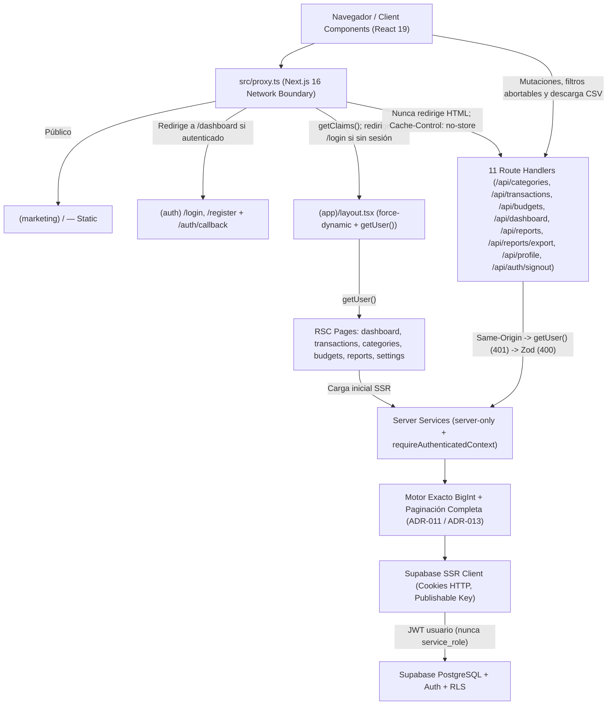

# Arquitectura de Software — FinTrack

> **Estado actual:** **Fase 05 auditada, optimizada y verificada** contra Supabase PostgreSQL real (`36/36` unitarias, `18/18` RLS, `42/42` seguridad API, `18/18` E2E Fase 04 + `63/63` responsive, `24/24` Fase 05 incluyendo volumen real de `1,005` filas en Supabase e instalación limpia reproducible `npm ci` + `npm run build`). Listo para despliegue en Fase 06.

## 1. Arquitectura General, Autenticación y Flujo de Datos (Fase 04)

## 2. Modelo Entidad-Relación en PostgreSQL (Migraciones Versionadas)

## 3. Contratos de Route Handlers Internos

Todos los Route Handlers privados aplican el mismo orden defensivo:
1. Validación `isValidSameOrigin(request)` en mutaciones (`POST`, `PATCH`, `DELETE`) → HTTP `403`.
2. Verificación autoritativa `requireAuthenticatedContext()` vía `supabase.auth.getUser()` → HTTP `401` (siempre **antes** de validar cuerpo o parámetros para no filtrar esquemas a usuarios anónimos).
3. Validación de UUIDs, query params y payload con Zod → HTTP `400`.
4. Ejecución de servicio `server-only` sujeto a RLS y mapeo controlado de errores (`404`, `409`, `500`) con cabecera `Cache-Control: no-store, private, max-age=0` y `Vary: Cookie`.

| Endpoint | Métodos | Responsabilidad principal |
| :--- | :--- | :--- |
| `/api/categories` | `GET`, `POST` | Listado con conteo exacto de uso y creación con unicidad (`409`) |
| `/api/categories/[id]` | `PATCH`, `DELETE` | Edición (bloqueo `409` al cambiar tipo en uso) y borrado seguro (`409` si vinculada) |
| `/api/transactions` | `GET`, `POST` | Listado paginado + totales exactos `BigInt` sobre todo el filtro y creación validada |
| `/api/transactions/[id]` | `GET`, `PATCH`, `DELETE` | Consulta, edición con validación de compatibilidad tipo-categoría y eliminación |
| `/api/budgets` | `GET`, `POST` | Presupuestos mensuales con consumo real en 4 estados y creación exclusiva para gastos |
| `/api/budgets/[id]` | `PATCH`, `DELETE` | Edición de límite/umbral y eliminación sin afectar transacciones |
| `/api/dashboard` | `GET` | Balance histórico acumulado + KPIs, series mensuales, dona de gastos y 5 recientes |
| `/api/reports` | `GET` | Resúmenes por período/rango personalizado y comparativas (`changePct: null` si base `0`) |
| `/api/reports/export` | `GET` | Exportación `text/csv; charset=utf-8` con BOM UTF-8, RFC 4180 y anti Formula Injection |
| `/api/profile` | `GET`, `PATCH` | Lectura y actualización del nombre del perfil |
| `/api/auth/signout` | `POST` | Cierre de sesión seguro en servidor |

## 4. Índices Justificados (`20261126230000_initial_schema.sql`)

| Índice | Tabla y Columnas | Consulta que optimiza |
| :--- | :--- | :--- |
| `idx_categories_unique_name` | `categories (user_id, type, lower(btrim(name)))` | Unicidad de nombre insensible a mayúsculas/espacios por usuario y tipo |
| `idx_categories_user_type` | `categories (user_id, type)` | Listado de categorías separado por ingresos y gastos |
| `idx_transactions_user_occurred_on` | `transactions (user_id, occurred_on DESC, created_at DESC)` | Historial paginado y recientes del dashboard |
| `idx_transactions_user_type_occurred_on` | `transactions (user_id, type, occurred_on DESC)` | Agregaciones de ingresos/gastos por período y cálculo de presupuestos |
| `idx_transactions_category_id` | `transactions (category_id)` | Filtro por categoría y validación rápida de `ON DELETE RESTRICT` |
| `idx_budgets_user_month` | `budgets (user_id, month)` | Consulta mensual de presupuestos en `/budgets` |

## 5. Registro de Decisiones de Arquitectura (ADR)

- **ADR-001:** Aritmética monetaria exclusivamente en centavos enteros (`BIGINT`, techo individual `900,000,000,000,000` seguro bajo `Number.MAX_SAFE_INTEGER`).
- **ADR-002:** Zona horaria determinista `America/El_Salvador` (UTC-6 sin DST) y fechas calendario `DATE` (`YYYY-MM-DD`).
- **ADR-003 / ADR-009:** Sin `cacheComponents`/`partialPrefetching`, `export const dynamic = "force-dynamic"` en `(app)/layout.tsx` y `Cache-Control: no-store, private` en todos los Route Handlers privados, manteniendo `/` estático.
- **ADR-004:** `@types/node@^22` alineado con `Node.js v22.19.0` para compatibilidad limpia con `vitest@5.1.2`.
- **ADR-005:** `shadcn/ui` (`base-nova` sobre `@base-ui/react@1.9.0`) nativo para React 19 y Tailwind CSS v4.
- **ADR-006:** `demo-data.ts` restringido únicamente a la vista previa demostrativa en `/` y pruebas unitarias; ninguna ruta privada utiliza datos mock.
- **ADR-007:** Tipografía `Geist` autoalojada (`geist@1.9.2`) para compilación reproducible sin dependencias externas de fuentes.
- **ADR-008:** Contraste WCAG AA ajustado (`--primary: #047857`, `--danger-text: #B91C1C`, `--warning-text: #B45309`).
- **ADR-010:** Defensa en profundidad en autenticación: `src/proxy.ts` (`getClaims()`) + `(app)/layout.tsx` (`getUser()`) + Route Handlers (`Same-Origin` → `getUser()` → `Zod`) + RLS forzado en PostgreSQL.
- **ADR-011 — Motor Monetario Acumulado en Precisión Arbitraria (`BigInt` + `ExactCents`) [Implementado y Verificado en Fase 04]:**
  - Todas las agregaciones de servidor (`transactions.service.ts`, `budgets.service.ts`, `dashboard.service.ts`, `reports.service.ts`, `financial-aggregations.ts`) suman centavos con `BigInt` y serializan totales como cadenas decimales exactas `ExactCents` (`string`).
  - `formatExactCurrency` y `exactCentsToDecimalString` (`src/lib/money.ts`) formatean mediante división entera `BigInt` sin pasar por `number` IEEE-754, verificado con pruebas unitarias por encima de `Number.MAX_SAFE_INTEGER` (`$108,000,000,000,000.01`).
  - La conversión a `number` queda confinada exclusivamente a `exactCentsToChartNumber` para coordenadas de trazado en Recharts, mientras tooltips, KPIs, tablas y CSV leen los valores exactos `ExactCents`.
- **ADR-012 — Gestión del Historial de Migraciones Aplicadas vía SQL Editor:** Nunca alterar migraciones ya aplicadas; toda evolución SQL futura entra como nueva migración idempotente con timestamp posterior. En Fase 04 no se requirió ninguna migración SQL nueva.
- **ADR-013 — Agregaciones Completas sin Truncamiento PostgREST, Deduplicación Multi-lote y Memoización por Petición [Reforzado y Verificado en Fase 05]:**
  - `collectPaginatedBatches` (`src/lib/batch-pagination.ts`) recorre lotes ordenados determinísticamente de `1000` filas con deduplicación por `id` (`seenIds`) y propagación estricta de errores en lotes intermedios (verificado unitariamente hasta `2,500` filas y en vivo contra Supabase con `1,005` filas reales).
  - `requireAuthenticatedContext()` (`src/services/_auth.ts`) usa `React.cache()` estrictamente por petición HTTP para evitar llamadas redundantes a `supabase.auth.getUser()` entre layout, Server Components, Route Handlers y servicios (reduciendo latencias de API de ~750–815 ms a `541–568 ms`).
  - `listTransactions` calcula totales en memoria cuando la página 1 contiene todos los resultados y `budgets.service.ts` usa `fetchExpenseTotalsByCategory` ligero (`id, category_id, amount_cents`).
  - Los Client Components derivan `isLoading` vía `settledKey !== requestKey`, cancelan peticiones obsoletas con `AbortController`, redirigen limpiamente ante HTTP `401` y muestran `<ErrorAlert>` en lugar de cifras `$0.00` engañosas cuando ocurre un fallo de servidor o red.
