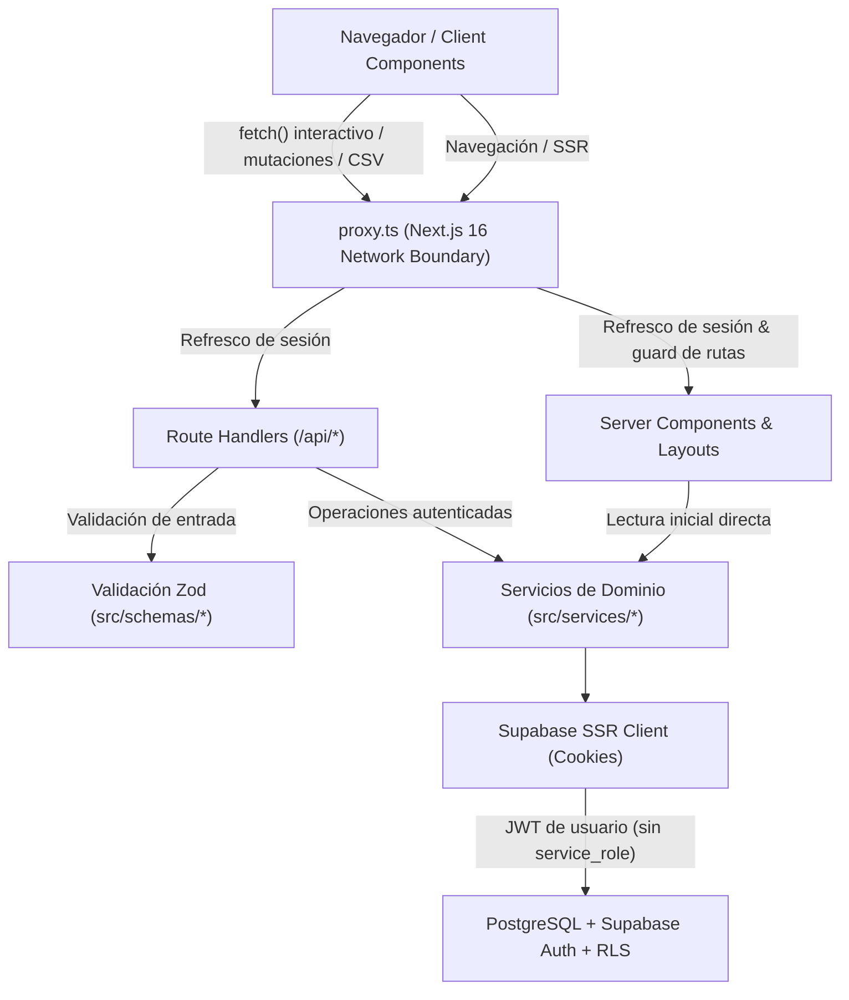
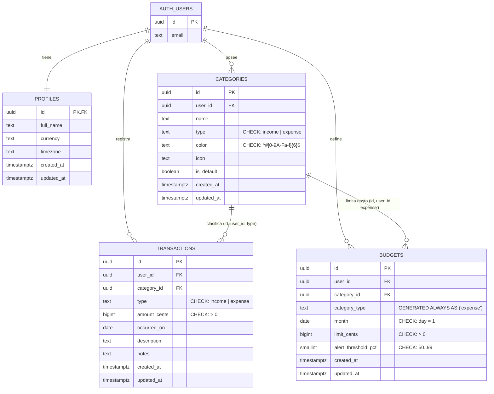

# Implementation Plan — FinTrack ("Tus finanzas, bajo control")

> **Proyecto:** FinTrack — Aplicación Web SaaS de Gestión de Finanzas Personales  
> **Contexto Académico:** Implementación de Aplicación Next.js mediante Vibe Coding: Flujo de Desarrollo Guiado por IA  
> **Fase Actual:** Fase 01 — Planificación, arquitectura e instrucciones permanentes  
> **Fecha de elaboración:** 26 de noviembre de 2026  
> **Idioma / Moneda / Zona horaria:** Español (`es-SV`) · USD (`$`) · `America/El_Salvador` (UTC-6, sin horario de verano)

---

## 1. Diagnóstico del Workspace y Entorno Local

Inspección no destructiva ejecutada sobre la raíz del repositorio (`fintrack`):

| Componente | Estado / Versión verificada | Observación |
| :--- | :--- | :--- |
| **Directorio de trabajo** | Raíz del repositorio (`0` archivos) | Vacío y listo para inicialización limpia en Fase 02 |
| **Sistema Operativo** | Windows 11 (`NT 10.0.26300.0`) | Shell PowerShell |
| **Node.js** | `v22.19.0` | Compatible con Next.js 16 y `@supabase/supabase-js` (`>=22.0.0`) |
| **npm / npx** | `10.9.3` / `10.9.3` | Gestor de paquetes seleccionado (sin instalaciones adicionales) |
| **pnpm** | No instalado | Se usará `npm` de forma consistente |
| **Git** | `2.43.0.windows.1` | Identidad global configurada; `init.defaultBranch` sin definir (se inicializará con `git init -b main`) |
| **CLIs externas (`gh`, `vercel`, `supabase`)** | No instaladas globalmente | Se usarán migraciones SQL versionadas + `git` + `npx` o integración web en Fase 03 y Fase 06 |

---

## 2. Alcance Funcional

### 2.1 Módulos Incluidos

1. **Landing Page (`/`)**: Propuesta de valor de FinTrack, presentación visual del producto, resumen de funcionalidades clave (dashboard, transacciones, presupuestos, reportes), llamados a la acción y accesos directos a `/register` y `/login`.
2. **Autenticación (`/login`, `/register`, `/auth/callback`)**: Registro con nombre completo, correo y contraseña; inicio de sesión; cierre de sesión; gestión de sesión por cookies HTTP; protección de rutas privadas; redirección inteligente si ya existe sesión; validación y mensajes claros en español.
3. **Dashboard (`/dashboard`)**:
   - KPIs: Balance acumulado histórico, Ingresos del período seleccionado, Gastos del período seleccionado y Flujo de efectivo neto del período.
   - Gráfico de evolución/flujo de efectivo.
   - Gráfico de distribución de gastos por categoría.
   - Lista de transacciones recientes con acceso rápido a registrar nueva transacción.
   - Selector interactivo de período (mes actual, meses anteriores, últimos 3/6 meses o año en curso).
4. **Transacciones (`/transactions`)**:
   - Registro, edición y eliminación de ingresos y gastos.
   - Búsqueda por texto (descripción y notas) con debounce.
   - Filtros combinables por rango de fechas, tipo (`income` / `expense`) y categoría.
   - Validación estricta de importes positivos, fechas válidas y compatibilidad categoría-tipo.
5. **Categorías (`/categories`)**:
   - Sembrado automático de categorías iniciales de ingresos y gastos al registrarse el usuario.
   - Creación y edición de categorías personalizadas (nombre, tipo, color hexadecimal e icono curado de Lucide).
   - Eliminación segura: impide eliminar categorías con transacciones o presupuestos asociados, informando el motivo y conteo exacto al usuario.
6. **Presupuestos (`/budgets`)**:
   - Definición de presupuestos mensuales por categoría de gasto (único por usuario, categoría y mes).
   - Seguimiento automático del monto gastado real del mes seleccionado.
   - Barras de progreso con estados visuales: saludable (`< 80%`), advertencia al acercarse al límite (`>= 80%` y `< 100%`) y alerta crítica al superar el límite (`>= 100%`).
7. **Reportes (`/reports`)**:
   - Comparaciones mensuales (mes actual vs. mes anterior y serie mensual).
   - Evolución histórica de ingresos vs. gastos.
   - Distribución de gastos por categoría en el rango seleccionado.
   - Filtros por período.
   - Exportación de transacciones filtradas en formato **CSV** (UTF-8 con BOM para compatibilidad en Excel y protección contra inyección de fórmulas).
8. **Configuración (`/settings`)**:
   - Visualización de datos de cuenta (correo, moneda USD, zona horaria `America/El_Salvador`).
   - Edición del nombre completo del perfil.
   - Gestión de sesión (cierre de sesión seguro).

### 2.2 Exclusiones Explícitas (Fuera de Alcance)
- Conexiones bancarias (Open Banking / Plaid).
- Pagos electrónicos o pasarelas de cobro.
- Suscripciones de pago o facturación SaaS.
- Asesoramiento financiero automatizado o IA generativa dentro del producto.
- Backend independiente fuera de Next.js + Supabase.

---

## 3. Arquitectura del Sistema

Se adoptará una **arquitectura modular en capas** dentro de Next.js App Router, manteniendo una separación estricta entre presentación, lógica de negocio, validación y acceso a datos.



### Principios Arquitectónicos Clave
1. **Server Components por defecto**: Las páginas y layouts cargan datos iniciales en el servidor invocando directamente `src/services/*`, reduciendo JavaScript enviado al cliente y mejorando LCP.
2. **Route Handlers reales para consumo cliente**: Toda mutación (CRUD de transacciones, categorías, presupuestos, perfil, cierre de sesión), búsqueda filtrada dinámica, cambio de período interactivo y exportación CSV consume `/api/*` mediante `fetch`, cumpliendo genuinamente el requisito académico de consumo de API.
3. **Aritmética financiera exacta**: Todo importe monetario se almacena, suma y transporta en **centavos enteros (`amount_cents`, `limit_cents`)** y se formatea a USD únicamente en la capa de presentación.
4. **Integridad de zona horaria**: Las fechas de transacción se guardan como PostgreSQL `DATE` (`YYYY-MM-DD`) y el "hoy" / mes actual se calcula siempre con `America/El_Salvador` para evitar desfases nocturnos por UTC.

---

## 4. Stack Tecnológico y Compatibilidad Verificada

Versiones estables verificadas contra documentación oficial y registro npm (noviembre 2026) — todos los servicios en **capa gratuita**:

| Tecnología / Paquete | Versión objetivo | Rol | Notas de compatibilidad verificadas |
| :--- | :--- | :--- | :--- |
| **Next.js** | `16.4.x` (estable) | Framework Full Stack (App Router) | React 19 nativo, Turbopack por defecto, `proxy.ts` reemplaza a `middleware.ts`, `cookies()`/`params`/`searchParams` asíncronos. Se mantendrá renderizado dinámico para rutas autenticadas (evitar cachear datos privados con `cacheComponents`). |
| **React / React DOM** | `19.x` | UI Runtime | Compatible con Next.js 16, Tailwind v4, shadcn/ui y Recharts v3. |
| **TypeScript** | `5.x` (`strict: true`) | Tipado estático | Modo estricto activado en `tsconfig.json`. |
| **Tailwind CSS** | `4.x` (`4.3.x`) | Estilos | Configuración CSS-first con `@import "tailwindcss"` y `@theme inline` en `globals.css`. |
| **shadcn/ui** | CLI `@latest` | Componentes accesibles | Soporte nativo para React 19 y Tailwind CSS v4 (sin `forwardRef` heredado). |
| **Lucide React** | `1.x` | Iconografía | Catálogo ligero con tree-shaking; lista curada para iconos de categorías. |
| **Recharts** | `3.x` (`3.11.x`) | Gráficos financieros | Compatible con React 19; envuelto en Client Components responsivos. |
| **@supabase/supabase-js** | `2.x` | Cliente Supabase | Requiere Node.js `>=22.0.0` (verificado: `v22.19.0`). |
| **@supabase/ssr** | `0.12.x` | Auth SSR con cookies | Uso oficial con `createServerClient`, `createBrowserClient`, `proxy.ts` y `getClaims()` / `getUser()`. |
| **Zod** | `4.x` | Validación de esquemas | Requiere `@hookform/resolvers >= 5.0.0`; evitar coerción implícita ambigua en formularios manejando conversión explícita a centavos. |
| **React Hook Form** | `7.x` | Gestión de formularios | Integración tipada con `@hookform/resolvers` (`^5` / `7.x`). |
| **Sonner** | `2.x` | Notificaciones Toast | Estándar oficial recomendado por shadcn/ui. |
| **ESLint** | `9.x` + `eslint-config-next` | Linting | Flat config de Next.js 16. |
| **Vitest** *(propuesto devDependency)* | `latest` | Pruebas unitarias | Ligero y gratuito para validar cálculos financieros en centavos, fechas en `America/El_Salvador`, CSV y esquemas Zod. *(Requiere aprobación en §17)*. |

---

## 5. Estructura de Carpetas Propuesta

```text
fintrack/
├── .agents/
│   └── rules/
│       └── fintrack-standards.md       # Reglas persistentes nativas de Antigravity
├── docs/
│   ├── ARCHITECTURE.md                 # Arquitectura detallada y decisiones (ADR)
│   ├── TESTING.md                      # Estrategia y registro real de pruebas
│   ├── prompts/
│   │   ├── README.md                   # Índice de prompts del proceso Vibe Coding
│   │   └── 001-master-planning.md      # Registro íntegro del Prompt 001 (y sucesivos)
│   └── screenshots/                    # Evidencias visuales reales (desktop/móvil)
├── supabase/
│   └── migrations/
│       ├── 0001_initial_schema.sql     # Tablas, restricciones, índices y triggers
│       └── 0002_rls_and_seed.sql       # Políticas RLS y trigger de perfil + categorías iniciales
├── src/
│   ├── app/
│   │   ├── layout.tsx                  # Root layout (Geist, lang="es", Toaster)
│   │   ├── globals.css                 # Tailwind v4 + tokens FinTrack
│   │   ├── not-found.tsx               # Página 404 personalizada
│   │   ├── error.tsx                   # Error boundary global
│   │   ├── (marketing)/
│   │   │   ├── layout.tsx              # Layout público (Navbar + Footer)
│   │   │   └── page.tsx                # Landing page (/)
│   │   ├── (auth)/
│   │   │   ├── layout.tsx              # Layout centrado con branding FinTrack
│   │   │   ├── login/page.tsx          # /login
│   │   │   └── register/page.tsx       # /register
│   │   ├── (app)/
│   │   │   ├── layout.tsx              # AppShell protegido (Sidebar + Header + MobileNav)
│   │   │   ├── loading.tsx             # Skeleton global del área privada
│   │   │   ├── error.tsx               # Error boundary del área privada
│   │   │   ├── dashboard/page.tsx      # /dashboard
│   │   │   ├── transactions/page.tsx   # /transactions
│   │   │   ├── categories/page.tsx     # /categories
│   │   │   ├── budgets/page.tsx        # /budgets
│   │   │   ├── reports/page.tsx        # /reports
│   │   │   └── settings/page.tsx       # /settings
│   │   ├── auth/
│   │   │   └── callback/route.ts       # Callback PKCE de Supabase Auth
│   │   └── api/
│   │       ├── auth/signout/route.ts
│   │       ├── dashboard/route.ts
│   │       ├── transactions/
│   │       │   ├── route.ts
│   │       │   └── [id]/route.ts
│   │       ├── categories/
│   │       │   ├── route.ts
│   │       │   └── [id]/route.ts
│   │       ├── budgets/
│   │       │   ├── route.ts
│   │       │   └── [id]/route.ts
│   │       ├── reports/
│   │       │   ├── route.ts
│   │       │   └── export/route.ts
│   │       └── profile/route.ts
│   ├── components/
│   │   ├── ui/                         # Primitivos shadcn/ui
│   │   ├── layout/                     # AppSidebar, AppHeader, MobileNav, BrandLogo
│   │   ├── shared/                     # PageHeader, EmptyState, ErrorAlert, MoneyDisplay, CategoryIcon
│   │   ├── auth/                       # LoginForm, RegisterForm
│   │   ├── dashboard/                  # KpiCards, CashflowChart, ExpensePieChart, RecentTransactions, PeriodSelector
│   │   ├── transactions/               # TransactionsView, TransactionFormDialog, TransactionFilters, DeleteDialog
│   │   ├── categories/                 # CategoriesView, CategoryFormDialog, ColorPicker, IconPicker
│   │   ├── budgets/                    # BudgetsView, BudgetCard, BudgetFormDialog
│   │   ├── reports/                    # ReportsView, MonthlyComparisonChart, TrendChart, ExportCsvButton
│   │   └── settings/                   # ProfileForm, SessionCard
│   ├── hooks/                          # useDebounce, useApiMutation, etc.
│   ├── lib/
│   │   ├── supabase/
│   │   │   ├── client.ts               # Browser client (@supabase/ssr)
│   │   │   ├── server.ts               # Server client (@supabase/ssr + async cookies)
│   │   │   └── proxy.ts                # Helper de actualización de sesión para proxy.ts
│   │   ├── money.ts                    # Conversión USD <-> centavos enteros y formateo
│   │   ├── dates.ts                    # Utilidades de fechas y meses en America/El_Salvador
│   │   ├── csv.ts                      # Serialización CSV segura (BOM + anti-inyección)
│   │   ├── api-response.ts             # Envoltorio estándar de respuestas y errores HTTP
│   │   ├── category-icons.ts           # Catálogo curado de iconos Lucide + colores
│   │   └── utils.ts                    # Helper cn()
│   ├── schemas/                        # auth.schema.ts, transaction.schema.ts, category.schema.ts, budget.schema.ts, profile.schema.ts
│   ├── services/                       # dashboard.service.ts, transactions.service.ts, categories.service.ts, budgets.service.ts, reports.service.ts, profile.service.ts
│   ├── types/                          # database.ts, domain.ts, api.ts
│   └── proxy.ts                        # Next.js 16 Proxy (sesión y protección de rutas)
├── tests/                              # Pruebas unitarias (money, dates, csv, schemas, calculations)
├── .env.example                        # Variables documentadas sin credenciales reales
├── .gitignore                          # Excluye .env*, node_modules, .next, etc.
├── AGENTS.md                           # Instrucciones permanentes del proyecto
├── README.md                           # Documentación principal + enlace de producción
└── VIBE_CODING.md                      # Bitácora real e iterativa de desarrollo
```

---

## 6. Modelo Entidad-Relación y Base de Datos (PostgreSQL / Supabase)



### Reglas de Integridad Reforzadas a Nivel de Base de Datos
La base de datos bloqueará cualquier operación inválida **incluso fuera de la UI**:

1. **Propiedad y compatibilidad de tipo en `transactions`**:
   - `categories` declara `UNIQUE (id, user_id, type)`.
   - `transactions` declara `FOREIGN KEY (category_id, user_id, type) REFERENCES public.categories(id, user_id, type) ON DELETE RESTRICT`.
   - Garantiza simultáneamente: (a) la categoría pertenece al mismo usuario, (b) el `type` de la transacción coincide exactamente con el `type` de la categoría, y (c) no se puede borrar una categoría ni mutar su tipo si tiene transacciones asociadas.
2. **Presupuestos exclusivos para categorías de gasto y propiedad del usuario**:
   - `budgets` incluye columna generada `category_type text GENERATED ALWAYS AS ('expense') STORED` y `FOREIGN KEY (category_id, user_id, category_type) REFERENCES public.categories(id, user_id, type) ON DELETE RESTRICT`.
   - Impide asociar un presupuesto a una categoría de ingreso o a una categoría de otro usuario.
3. **Unicidad de presupuestos por mes**:
   - `month DATE NOT NULL CHECK (EXTRACT(DAY FROM month) = 1)` + `UNIQUE (user_id, category_id, month)`.
4. **Unicidad de nombres de categorías por usuario y tipo**:
   - Índice único `CREATE UNIQUE INDEX idx_categories_unique_name ON public.categories (user_id, type, LOWER(TRIM(name)))`.
5. **Importes monetarios seguros**:
   - `amount_cents BIGINT NOT NULL CHECK (amount_cents > 0)` y `limit_cents BIGINT NOT NULL CHECK (limit_cents > 0)`.
6. **Índices de rendimiento**:
   - `idx_transactions_user_date` en `(user_id, occurred_on DESC, created_at DESC)`.
   - `idx_transactions_user_type_date` en `(user_id, type, occurred_on DESC)`.
   - `idx_transactions_user_category` en `(user_id, category_id)`.
   - `idx_budgets_user_month` en `(user_id, month)`.
   - `idx_categories_user_type` en `(user_id, type)`.
7. **Triggers automáticos**:
   - `handle_new_user()` (`AFTER INSERT ON auth.users`, `SECURITY DEFINER`, `SET search_path = public`): crea el registro en `profiles` y siembra las 12 categorías iniciales en español (4 de ingresos: *Salario, Freelance, Inversiones, Otros ingresos*; 8 de gastos: *Alimentación, Vivienda, Transporte, Servicios, Salud, Entretenimiento, Educación, Otros gastos*).
   - `set_updated_at()` (`BEFORE UPDATE`) en las 4 tablas públicas.

---

## 7. Estrategia de Seguridad

| Capa | Medida concreta |
| :--- | :--- |
| **Sesiones y Cookies** | `@supabase/ssr` con cookies HTTP gestionadas en `src/proxy.ts` (Next.js 16) y `src/lib/supabase/server.ts`. |
| **Verificación de identidad en servidor** | `proxy.ts` refresca el token y valida sesión con `supabase.auth.getClaims()` para redirecciones rápidas; los layouts protegidos y **todos** los Route Handlers ejecutan `supabase.auth.getUser()` (verificación autoritativa). Nunca se usa `getSession()` para autorización en servidor. |
| **Aislamiento de datos (RLS)** | `ALTER TABLE ... ENABLE ROW LEVEL SECURITY` en `profiles`, `categories`, `transactions` y `budgets`, con políticas separadas de `SELECT`, `INSERT`, `UPDATE`, `DELETE` exigiendo `(SELECT auth.uid()) = user_id` (o `= id` en `profiles`). |
| **Principio de mínimo privilegio** | Cero uso de `service_role` en código de aplicación. Solo se emplea la clave pública (`NEXT_PUBLIC_SUPABASE_PUBLISHABLE_KEY` / anon) sujeta a RLS. |
| **Validación de entradas** | Doble validación con esquemas **Zod** (en cliente con React Hook Form y obligatoriamente en el servidor en cada Route Handler). |
| **Exportación CSV segura** | Escapado de comillas/comas y neutralización de celdas que inicien con `=`, `+`, `-`, `@`, `\t` o `\r` (prevención de CSV Formula Injection). |
| **Manejo seguro de errores** | Respuestas sanitizadas en español; nunca se exponen stack traces, nombres de constraints internos ni detalles SQL al cliente. |
| **Secretos y configuración** | `.env.local` excluido en `.gitignore`, `.env.example` documentado sin valores reales y cabeceras HTTP de seguridad básicas en `next.config.ts`. |

---

## 8. Mapa de Rutas

| Ruta | Route Group | Acceso | Propósito |
| :--- | :--- | :--- | :--- |
| `/` | `(marketing)` | Público | Landing page de presentación y CTAs |
| `/login` | `(auth)` | Público (redirige a `/dashboard` si autenticado) | Inicio de sesión |
| `/register` | `(auth)` | Público (redirige a `/dashboard` si autenticado) | Registro de cuenta |
| `/auth/callback` | — | Público (PKCE) | Intercambio de código de autenticación por sesión |
| `/dashboard` | `(app)` | Privado | Resumen financiero, KPIs, gráficos y recientes |
| `/transactions` | `(app)` | Privado | Gestión CRUD, búsqueda y filtros de transacciones |
| `/categories` | `(app)` | Privado | Gestión de categorías personalizadas e iniciales |
| `/budgets` | `(app)` | Privado | Presupuestos mensuales, progreso y alertas |
| `/reports` | `(app)` | Privado | Análisis comparativo, tendencias y exportación CSV |
| `/settings` | `(app)` | Privado | Perfil de usuario y cierre de sesión |

---

## 9. Diseño de APIs (Route Handlers)

Todos los endpoints bajo `/api/*` requieren sesión válida (excepto si se invoca `signout` de forma idempotente) y devuelven JSON estructurado: `{ data, error, meta? }`.

| Endpoint | Métodos | Funcionalidad | Códigos esperados |
| :--- | :--- | :--- | :--- |
| `/api/dashboard` | `GET` | KPIs, flujo de efectivo, distribución por categoría y 5 recientes según `?period=YYYY-MM` o rango (`last_3m`, `last_6m`, `year`) | `200`, `400`, `401` |
| `/api/transactions` | `GET`, `POST` | Listado paginado y filtrado (`q`, `type`, `categoryId`, `from`, `to`, `page`, `pageSize`); creación validada con Zod | `200`, `201`, `400`, `401` |
| `/api/transactions/[id]` | `GET`, `PATCH`, `DELETE` | Consulta, edición y eliminación de una transacción del usuario | `200`, `400`, `401`, `404` |
| `/api/categories` | `GET`, `POST` | Listado con conteo de uso opcional; creación de categoría personalizada | `200`, `201`, `400`, `401`, `409` |
| `/api/categories/[id]` | `PATCH`, `DELETE` | Edición y eliminación segura (retorna `409` si tiene transacciones o presupuestos asociados) | `200`, `400`, `401`, `404`, `409` |
| `/api/budgets` | `GET`, `POST` | Presupuestos del mes (`?month=YYYY-MM`) con gasto calculado y porcentaje; creación de presupuesto | `200`, `201`, `400`, `401`, `409` |
| `/api/budgets/[id]` | `PATCH`, `DELETE` | Actualización de límite/umbral y eliminación | `200`, `400`, `401`, `404` |
| `/api/reports` | `GET` | Comparación mensual, serie temporal ingresos vs. gastos y desglose por categoría (`?months=6` o `?from=&to=`) | `200`, `400`, `401` |
| `/api/reports/export` | `GET` | Descarga de archivo `fintrack-transacciones-YYYY-MM-DD.csv` filtrado y sanitizado | `200`, `400`, `401` |
| `/api/profile` | `GET`, `PATCH` | Lectura y actualización del nombre completo del perfil | `200`, `400`, `401` |
| `/api/auth/signout` | `POST` | Cierre de sesión en Supabase y limpieza de cookies | `200` |

---

## 10. Distribución entre Server Components y Client Components

| Capa / Módulo | Tipo | Justificación |
| :--- | :--- | :--- |
| `src/app/layout.tsx`, `(marketing)/*`, `(auth)/layout.tsx`, `(app)/layout.tsx` | **Server Component** | Renderizado SSR ligero, verificación de sesión en servidor y carga del perfil sin waterfall cliente. |
| Páginas `dashboard`, `transactions`, `categories`, `budgets`, `reports`, `settings` | **Server Component** | Carga inicial directa desde `src/services/*` para primer pintado inmediato (SSR) y paso de `initialData` a vistas interactivas. |
| Formularios (`LoginForm`, `RegisterForm`, `TransactionFormDialog`, `CategoryFormDialog`, `BudgetFormDialog`, `ProfileForm`) | **Client Component** | Uso de `react-hook-form`, validación interactiva, manejo de envío a Route Handlers y notificaciones con `sonner`. |
| Gráficos (`CashflowChart`, `ExpensePieChart`, `MonthlyComparisonChart`, `TrendChart`) | **Client Component** | Recharts requiere DOM/ResizeObserver y tooltips interactivos. |
| Navegación interactiva (`AppSidebar`, `MobileNav`, `PeriodSelector`) | **Client Component** | Uso de `usePathname()`, estado de menú móvil (`Sheet`) y navegación por teclado. |
| Vistas con búsqueda/filtros dinámicos (`TransactionsView`, `DashboardView`, `BudgetsView`, `ReportsView`) | **Client Component** | Consumo reactivo de `/api/*` con estados de carga, error y sincronización de filtros. |

### Uso Funcional y Justificado de `useState` y `useEffect`
- **`useDebounce` (`src/hooks/use-debounce.ts`)**: `useState` + `useEffect` con `setTimeout`/`clearTimeout` para evitar peticiones excesivas al buscar transacciones.
- **`TransactionsView`**: `useState` para filtros, paginación, modales y estado `isLoading`/`error`; `useEffect` con `AbortController` para consultar `GET /api/transactions` cuando cambian los filtros debounced, cancelando peticiones obsoletas.
- **`DashboardView` y `ReportsView`**: `useState` para el período seleccionado y datos cargados; `useEffect` (con `AbortController`, omitiendo el primer render ya hidratado por SSR) para recargar `GET /api/dashboard` y `GET /api/reports` al cambiar el período.
- **`BudgetsView`**: `useState` para el mes activo (`YYYY-MM`) y estado del modal; `useEffect` para sincronizar datos de `GET /api/budgets?month=...` al navegar entre meses.

---

## 11. Sistema de Diseño (UI/UX)

### Identidad Visual — "Refined Emerald Fintech"
Estética limpia y editorial alejada de plantillas genéricas: contraste firme entre navegación en verde bosque profundo (`#10251F`) y un lienzo luminoso de alta legibilidad (`#F8FAFC` / `#FFFFFF`), cifras alineadas con `tabular-nums`, jerarquía tipográfica clara y microinteracciones discretas.

### Paleta y Tokens Semánticos

| Token | Valor Hex | Uso principal |
| :--- | :--- | :--- |
| `--brand-dark` | `#10251F` | Sidebar desktop, superficie de acento en landing y auth |
| `--brand-primary` | `#059669` | Acciones primarias, indicadores positivos/ingresos, estados activos |
| `--brand-accent` | `#34D399` | Realces sobre fondo oscuro, detalles de progreso y gráficos |
| `--bg-canvas` | `#F8FAFC` | Fondo general de la aplicación |
| `--bg-surface` | `#FFFFFF` | Tarjetas, modales, tablas y header |
| `--semantic-danger` | `#DC5656` | Gastos, presupuestos excedidos (`>= 100%`), acciones destructivas |
| `--semantic-warning` | `#D97706` | Advertencia de presupuesto cercano al límite (`80%–99%`) |
| `--text-primary` / `--text-muted` | `#0F172A` / `#475569` | Jerarquía de texto con contraste WCAG AA+ |

### Tipografía, Layout y Accesibilidad
- **Tipografía**: `Geist` (UI general) y `Geist Mono` (importes USD con `font-variant-numeric: tabular-nums`), cargadas con `next/font/google`.
- **Responsive**:
  - Desktop (`>= 1024px`): Sidebar fija (`256px`) + Header (`64px`) + grid fluido (hasta 4 columnas para KPIs).
  - Tablet (`768px–1023px`): Sidebar en drawer o colapsable + grids de 2 columnas.
  - Móvil (`< 768px`): Header compacto con botón de menú (`Sheet`), vistas de tabla adaptadas a tarjetas legibles y CTAs táctiles (`>= 44px`).
- **Estados completos**: Skeletons dedicados por módulo, estados vacíos con ilustración ligera/icono y CTA directo, alertas de error con botón de reintento, toasts con Sonner, foco visible (`focus-visible:ring`) y navegación por teclado en formularios y diálogos.

---

## 12. Estrategia de Pruebas y Calidad

1. **Verificación estática continua**: `npm run lint` (ESLint) y `npx tsc --noEmit` (TypeScript estricto) tras cada módulo.
2. **Compilación de producción**: `npm run build` en cada cierre de fase desde Fase 02.
3. **Pruebas unitarias automatizadas (Vitest)** en `tests/`:
   - Conversión exacta USD ↔ centavos enteros (incluyendo bordes como `$0.01`, `$19.99`, `$1000000.50` sin errores de punto flotante).
   - Cálculo de límites de mes en `America/El_Salvador`.
   - Cálculo de KPIs (balance, flujo neto, porcentaje de presupuesto y clasificación de alertas).
   - Sanitización CSV contra inyección de fórmulas.
   - Validación de esquemas Zod (casos válidos e inválidos).
4. **Pruebas de API y Seguridad (Fase 03 y Fase 05)**:
   - Acceso no autenticado a `/api/*` → `401`.
   - Payload inválido → `400`.
   - Eliminación de categoría en uso → `409`.
   - **Prueba de aislamiento multiusuario (RLS)**: Usuario A y Usuario B verificando imposibilidad de lectura, edición o borrado cruzado, y verificación en DB de restricciones de integridad (ej. intentar asignar categoría de ingreso a un presupuesto).
5. **Pruebas E2E y Responsive con Agente de Navegador (Fase 02, 04, 05 y 06)**:
   - Flujos completos de punta a punta en desktop (`1440×900`), tablet (`768×1024`) y móvil (`390×844`).
   - Verificación visual de estados de carga, vacíos, errores y capturas reales en `docs/screenshots/`.

---

## 13. Estrategia de Documentación Automática e Instrucciones Permanentes

Durante la inicialización en **Fase 02** (manteniendo el directorio limpio antes de `create-next-app`), se crearán y mantendrán actualizados en cada fase:

1. **Instrucciones permanentes del proyecto**:
   - `AGENTS.md` (raíz del proyecto): contexto académico, reglas de arquitectura, seguridad, convenciones de código, aritmética en centavos, zona horaria, prohibición de `service_role` y protocolo de actualización de `VIBE_CODING.md`.
   - `.agents/rules/fintrack-standards.md`: mecanismo nativo de reglas persistentes del workspace de Antigravity (verificado en la documentación oficial de Antigravity, bajo el límite de 24 KB), sincronizado con `AGENTS.md` para asegurar continuidad entre sesiones.
2. **Registro de prompts**:
   - `docs/prompts/README.md` (índice cronológico).
   - `docs/prompts/001-master-planning.md` (se escribirá con el texto íntegro del Prompt 001 ya resguardado en scratch) y un archivo por cada prompt de fase e iteraciones de corrección (`002-...`, `003-...`, `003-a-...`).
3. **Documentación viva**:
   - `VIBE_CODING.md`: actualizado al final de **cada fase** con los 16 campos obligatorios (fecha real, prompt, decisiones, archivos, problemas reales, soluciones, comandos, pruebas, commits y estado).
   - `docs/ARCHITECTURE.md`: arquitectura actualizada, diagrama ER, contratos API y ADRs.
   - `docs/TESTING.md`: matriz de pruebas ejecutadas y resultados verificables.
   - `README.md`: instalación local, variables de entorno, uso, capturas y URL real de producción en Fase 06.
   - `docs/screenshots/`: capturas reales verificadas.

---

## 14. Estrategia de Control de Versiones y Despliegue

### Git y GitHub
- Inicialización en Fase 02 con `git init -b main`.
- Convención: **Conventional Commits** (`chore:`, `docs:`, `feat:`, `fix:`, `test:`, `refactor:`).
- Revisión previa a cada commit (`git status` + `git diff --cached`) para asegurar cero credenciales y cambios atómicos reales.
- Publicación en repositorio público de GitHub en Fase 06.

### Producción (Vercel + Supabase — 100% Free Tier)
- **Supabase (Free Tier)**: proyecto PostgreSQL + Auth con migraciones versionadas en `supabase/migrations/`.
- **Vercel (Hobby Free Tier)**: conectado al repositorio de GitHub o desplegado vía CLI con las variables de entorno:
  - `NEXT_PUBLIC_SUPABASE_URL`
  - `NEXT_PUBLIC_SUPABASE_PUBLISHABLE_KEY`
  - `NEXT_PUBLIC_APP_URL`
- Configuración posterior en Supabase Auth (`Site URL` y `Redirect URLs` apuntando al dominio real de Vercel).
- Verificación funcional completa en la URL pública antes de cerrar Fase 06 y actualizar `README.md`.

---

## 15. Riesgos y Mitigaciones

| Riesgo | Impacto | Mitigación |
| :--- | :--- | :--- |
| Cambios de Next.js 16 (`proxy.ts` y `cacheComponents`) frente a patrones heredados | Alto | Implementar `src/proxy.ts` siguiendo la guía oficial de Supabase SSR + Next.js 16 y mantener rutas autenticadas dinámicas. |
| Conflictos de tipos entre Zod v4 y `@hookform/resolvers` | Medio | Instalar `@hookform/resolvers >= 5` y definir esquemas de formulario con entradas limpias sin `z.coerce` ambiguo. |
| Errores de redondeo decimal en totales financieros | Alto | Almacenamiento y cálculos 100% en centavos enteros (`BIGINT` / `number` entero). |
| Desfase de fechas al cambiar de día cerca de medianoche | Medio | Guardar fechas como `DATE` y resolver fecha/mes actual estrictamente en `America/El_Salvador`. |
| Límites de envío de correos de confirmación en Supabase Free Tier | Medio | Documentar claramente en Fase 03 la opción de desactivar confirmación por correo para pruebas académicas o usar cuentas de prueba controladas. |
| Ausencia de CLIs globales (`gh`, `vercel`, `supabase`) | Bajo | Usar `git`, `npm`, `npx` y paneles web oficiales cuando se requiera autenticación humana. |

---

## 16. Criterios de Aceptación por Fase

- **Fase 01 (Actual — Planificación)**: Workspace y entorno verificados sin modificaciones destructivas; Implementation Plan completo cubriendo los 17 aspectos requeridos; decisiones e intervenciones humanas identificadas; Prompt 001 resguardado para inicialización.
- **Fase 02 (Inicialización y Diseño)**: Next.js 16 + TypeScript estricto + Tailwind v4 + shadcn/ui + dependencias base instaladas; Git inicializado; `AGENTS.md`, `.agents/rules/`, `README.md`, `VIBE_CODING.md`, `docs/*` y `docs/prompts/001-master-planning.md` creados; `.env.example` documentado; sistema de diseño FinTrack, landing page `/` y AppShell responsive verificados con `lint`, `tsc`, `build` y navegador.
- **Fase 03 (BD, Seguridad y Auth)**: Migraciones SQL versionadas aplicadas en Supabase con restricciones de integridad, RLS y trigger de categorías iniciales; `src/proxy.ts` y clientes Supabase SSR operativos; `/register`, `/login`, cierre de sesión y protección de rutas privadas verificados con pruebas reales.
- **Fase 04 (Módulos Funcionales)**: Dashboard, Transacciones (CRUD + búsqueda/filtros), Categorías (CRUD + borrado seguro), Presupuestos (progreso + advertencias/alertas), Reportes (gráficos + exportación CSV) y Configuración (edición de perfil + sesión) 100% funcionales contra Supabase vía Server Components y Route Handlers.
- **Fase 05 (Testing, Seguridad y Optimización)**: Suite unitaria pasando, pruebas de API y aislamiento multiusuario RLS verificadas, auditoría E2E y responsive (desktop/tablet/móvil) en navegador con capturas reales, corrección de hallazgos, `lint` + `tsc` + `build` limpios y `docs/TESTING.md` completo.
- **Fase 06 (Documentación Final y Despliegue)**: Repositorio público en GitHub actualizado con historial limpio de commits, despliegue operativo en Vercel con variables configuradas, verificación en vivo en URL pública, `README.md` y `VIBE_CODING.md` finalizados con evidencias y enlace de producción.

---

## 17. Matriz de Cumplimiento Académico

| Requisito obligatorio | Implementación planificada en FinTrack | Fase de verificación |
| :--- | :--- | :--- |
| Next.js 16+ estable + App Router | `next@16.4.x`, `src/app/` con Route Groups y `src/proxy.ts` | Fases 02, 05, 06 |
| TypeScript (modo estricto) | `tsconfig.json` con `"strict": true` y `npx tsc --noEmit` | Fases 02–06 |
| Mínimo 4 páginas/rutas distintas | 9 rutas funcionales (`/`, `/login`, `/register`, `/dashboard`, `/transactions`, `/categories`, `/budgets`, `/reports`, `/settings`) | Fases 02–04 |
| Consumo de API mediante Route Handlers | 11 endpoints reales bajo `/api/*` consumidos desde Client Components | Fase 04, 05 |
| Uso combinado de Server y Client Components | Páginas/layouts como Server Components + vistas/formularios/gráficos como Client Components | Fases 02–05 |
| Uso funcional y justificado de `useState` y `useEffect` | Debounce de búsqueda, fetch abortable en filtros/períodos, control de modales y meses activos | Fase 04, 05 |
| Diseño responsive | Breakpoints desktop, tablet y móvil verificados en navegador con capturas | Fases 02, 04, 05 |
| Estados de carga y manejo de errores | `loading.tsx`, skeletons inline, `error.tsx`, alertas con reintento y toasts Sonner | Fases 02, 04, 05 |
| `.env.local` y `.env.example` documentado | `.env.local` ignorado en Git + `.env.example` documentado sin secretos | Fases 02, 03, 06 |
| Repositorio público en GitHub + historial iterativo | Commits reales con Conventional Commits desde Fase 02, push en Fase 06 | Fases 02–06 |
| `README.md` + `VIBE_CODING.md` | Creados en Fase 02, actualizados por fase y cerrados con URL pública en Fase 06 | Fases 02–06 |
| Aplicación desplegada públicamente | Producción en Vercel conectada a Supabase y verificada en vivo | Fase 06 |

---

## 18. Decisiones que Requieren Aprobación e Intervenciones Humanas Futuras

### A. Decisiones técnicas propuestas para aprobación antes de Fase 02
1. **Gestor de paquetes**: Usar `npm` (ya instalado en `v10.9.3`) en lugar de instalar `pnpm`.
2. **Runner de pruebas unitarias**: Incluir `vitest` como `devDependency` ligera y gratuita para validar cálculos financieros en centavos, fechas, CSV y esquemas Zod (además de ESLint, TypeScript y pruebas en navegador).
3. **Nombre de variable de entorno de clave pública Supabase**: Estandarizar en `NEXT_PUBLIC_SUPABASE_PUBLISHABLE_KEY` (estándar oficial actual de Supabase SSR, compatible tanto con la nueva Publishable Key como con la clave `anon` clásica).
4. **Borrado seguro de categorías**: Bloquear la eliminación (`409 Conflict`) cuando existan transacciones o presupuestos vinculados, mostrando el conteo exacto al usuario (sin borrado en cascada destructivo).

### B. Intervenciones humanas necesarias en fases posteriores
- **Fase 03 (Base de datos y Auth)**:
  1. Crear proyecto gratuito en [Supabase](https://supabase.com/) (o proporcionar uno existente).
  2. Configurar `.env.local` con `NEXT_PUBLIC_SUPABASE_URL` y `NEXT_PUBLIC_SUPABASE_PUBLISHABLE_KEY` (o brindar acceso para aplicar migraciones en el SQL Editor / Supabase CLI).
  3. Definir si en Supabase Auth se habilitará o desactivará la confirmación obligatoria por correo para facilitar el flujo de pruebas académicas.
- **Fase 06 (Publicación y Despliegue)**:
  1. Crear el repositorio público en GitHub y proporcionar su URL remota (y autenticación Git si el equipo aún no la tiene almacenada).
  2. Autorizar la cuenta gratuita en Vercel e ingresar las variables de entorno de producción (o autenticar `npx vercel login`) y agregar la URL final de Vercel en Supabase Auth (`Site URL` / `Redirect URLs`).


---

## Adenda — Fase 03 (2026-11-26)

Sin modificar el historial original de la Fase 01, se registran los siguientes ajustes arquitectónicos aprobados y verificados al iniciar la Fase 03:

1. **Verificación visual mediante Playwright aislado:** Ante la ausencia de depuración remota activa (`DevToolsActivePort`) en el perfil Chrome local, se incorporó `playwright` como `devDependency` con scripts reutilizables (`scripts/run-with-server.mjs`, `scripts/verify-phase-02.mjs`) para ejecutar auditorías en navegador aislado sin modificar el perfil personal del usuario.
2. **Walkthrough obligatorio por fase:** Se incorporó en `AGENTS.md` y `.agents/rules/fintrack-standards.md` la generación obligatoria de `walkthrough.md` (artefacto Antigravity) y copias versionadas en `docs/walkthroughs/`.
3. **Simplificación de renderizado en `next.config.ts` (ADR-009):** Se removieron `cacheComponents: true` y `partialPrefetching: true` antes de integrar Supabase SSR para mantener un renderizado dinámico por petición claro, determinista y seguro en rutas autenticadas, preservando el prerenderizado estático en las rutas públicas y `Cache-Control: no-store, private` en APIs privadas.
4. **Tipografía Geist autoalojada:** Se adoptó `geist@1.9.2` (`geist/font/sans` y `geist/font/mono`) para garantizar compilaciones deterministas sin dependencia externa de Google Fonts.


---

## Adenda Fase 04 — Módulos Funcionales Completos (2026-11-27)

Durante la ejecución autorizada de la Fase 04 (`PROMPT-004`) se concretaron los siguientes refinamientos alineados con el plan maestro y las ADRs previas:
1. **Motor Exacto `BigInt` (`ADR-011`):** Implementado en `src/lib/money.ts`, `src/lib/financial-aggregations.ts` y todos los servicios financieros (`src/services/*.service.ts`), transportando totales agregados como cadenas exactas `ExactCents` (`string`) y aislando la proyección numérica `exactCentsToChartNumber` exclusivamente al trazado visual en Recharts.
2. **Agregaciones Completas sin Truncamiento (`ADR-013`):** Implementación de `fetchAllUserTransactions` y `computeFilteredExactTotals` mediante barrido paginado en lotes ordenados determinísticamente de `1000` filas para evitar truncamientos en dashboard, presupuestos, reportes, totales filtrados y exportación CSV, sin requerir migraciones SQL adicionales.
3. **Presupuestos de 4 Estados:** Extensión de `BudgetStatus` y `BudgetProgress` con el estado exacto `"limit_reached"` (`100.0%` exacto) adicional a `"healthy"`, `"warning"` y `"exceeded"`.
4. **Orden Defensivo de Route Handlers:** Todos los 9 Route Handlers financieros nuevos validan `isValidSameOrigin` (en mutaciones) → `requireAuthenticatedContext()` (`401`) → validación de parámetros/cuerpo Zod (`400`) antes de invocar los servicios.
5. **Comparativas Seguras sin Base Cero:** `calculateComparisonPercentage` devuelve `null` cuando el período previo suma `0`, mostrando la etiqueta honesta `"Sin base previa"` en `/reports`.


---

## Adenda Fase 06 — Despliegue en Producción y Cierre Académico (2026-11-27)

- **Repositorio público:** https://github.com/reneg07/fintrack (`HTTP 200`, rama `main`).
- **Producción (Vercel Hobby):** https://fintrack-ten-weld-84.vercel.app (conectado a Supabase PostgreSQL real con `NEXT_PUBLIC_SUPABASE_URL`, `NEXT_PUBLIC_SUPABASE_PUBLISHABLE_KEY` y `NEXT_PUBLIC_APP_URL`; sin `service_role` ni variables QA).
- **Verificación real en producción (`npm run verify:prod`):** `15/15` comprobaciones aprobadas (`401` API sin sesión, acceso público `/`, login QA, CRUD transacción, categorías, presupuestos, reportes + descarga CSV real con BOM, perfil, móvil `390×844` sin desbordamiento, limpieza y signout, `0` errores).
- **Pendiente documentado:** Custom SMTP no configurado (se mantienen `Confirm email` y RLS activos).
