# Walkthrough — Fase 02: Inicialización del Proyecto y Sistema de Diseño UI/UX

> **Proyecto:** FinTrack (*Tus finanzas, bajo control*)  
> **Fase:** Fase 02 (Inicialización, sistema de diseño, landing page, autenticación preliminar y AppShell)  
> **Estado:** **Completada y verificada integralmente** (pendientes visuales de Fase 02 resueltos mediante Playwright + Chromium aislado al inicio de Fase 03)  
> **Fecha:** 2026-11-26  
> **Prompts relacionados:** [001-master-planning.md](../prompts/001-master-planning.md) · [002-initialization-and-design.md](../prompts/002-initialization-and-design.md) · [003-database-and-authentication.md](../prompts/003-database-and-authentication.md)

---

## 1. Objetivos de la Fase
- Inicializar Next.js 16+ estable con App Router, TypeScript estricto, Tailwind CSS v4, ESLint y `npm` en la raíz del workspace (`fintrack`).
- Instalar y validar compatibilidad del stack aprobado (`shadcn/ui`, `lucide-react`, `recharts`, `@supabase/supabase-js`, `@supabase/ssr`, `zod`, `react-hook-form`, `@hookform/resolvers`, `sonner`, `vitest`, `geist`, `playwright`).
- Configurar Git en rama `main`, instrucciones permanentes (`AGENTS.md` + `.agents/rules/fintrack-standards.md`), documentación viva y `.env.example`.
- Implementar la identidad visual *Refined Emerald Fintech*, la landing page `/`, las interfaces de `/login` y `/register` con React Hook Form + Zod, el AppShell responsive y las vistas preliminares de los 6 módulos financieros sobre un único origen de datos ficticios coherentes (`src/lib/demo-data.ts`).
- Ejecutar validaciones técnicas (`lint`, `typecheck`, `test`, `build`, `npm audit`) y verificación visual/responsive en 7 resoluciones con capturas reales.

## 2. Resumen de la Implementación y Funcionalidades Desarrolladas
- **Sistema de diseño y utilidades:** Tokens semánticos WCAG AA en [src/app/globals.css](../../src/app/globals.css), tipografía autoalojada `Geist` + `Geist Mono` (`geist@1.9.2`), favicon vectorial [src/app/icon.svg](../../src/app/icon.svg), 17 componentes `shadcn/ui` (`base-nova`), 11 componentes reutilizables (`BrandLogo`, `KpiCard`, `MoneyDisplay`, `CategoryIcon`, `BudgetProgress`, `PageHeader`, `EmptyState`, `ErrorAlert`, `DemoNotice`, `LoadingSkeleton`, `FinancialChart`), aritmética exacta en centavos enteros ([src/lib/money.ts](../../src/lib/money.ts)) y manejo determinista de `America/El_Salvador` ([src/lib/dates.ts](../../src/lib/dates.ts)).
- **Landing Page (`/`):** Navbar responsive, hero con vista previa conectada a `demo-data.ts`, 4 funcionalidades clave, flujo en 3 pasos, pilares honestos de privacidad, CTA final y footer.
- **Autenticación preliminar (`/login`, `/register`):** Validación React Hook Form + Zod con `autocomplete`, `aria-invalid`, `aria-describedby` y mostrar/ocultar contraseña sin simular sesiones falsas.
- **AppShell y 6 módulos financieros preliminares:** Sidebar fija de `256px` (`#10251F`) en escritorio, drawer `Sheet` en tablet/móvil, header sticky y vistas de `/dashboard`, `/transactions`, `/categories`, `/budgets`, `/reports` y `/settings`.

## 3. Decisiones Técnicas Relevantes
- **Contraste WCAG AA:** `--primary` ajustado a `#047857` (5.48:1 sobre blanco), `--danger-text` a `#B91C1C` y `--warning-text` a `#B45309`, manteniendo `#10251F`, `#059669`, `#34D399` y `#DC5656` como paleta de marca.
- **Geist local (`geist@1.9.2`):** Garantiza compilación determinista de `next build` sin requerir acceso externo a Google Fonts.
- **Resolución de bloqueo de navegador:** Ante la ausencia de `DevToolsActivePort` en el perfil Chrome del usuario, se incorporó `playwright` como `devDependency` (`scripts/verify-phase-02.mjs` + `scripts/run-with-server.mjs`) para ejecutar una instancia aislada de navegador sin alterar el perfil personal ni abrir puertos públicos.

## 4. Problemas Encontrados y Soluciones Implementadas
1. **Conflicto `ERESOLVE` de `vitest@5.1.2` con `@types/node@^20`:** Resuelto actualizando `@types/node` a `^22.20.7` (acorde a `Node.js v22.19.0`) sin `--force`.
2. **Error `TS2737` con literales BigInt (`100n`/`0n`):** Sustituido por `BigInt(100)` y `BigInt(0)` en `src/lib/money.ts`.
3. **Desbordamiento horizontal detectado por Playwright en `/` a `768x1024` (`824px` vs `768px`) y `360x800` (`365px` vs `360px`):** Se ajustó el breakpoint del navbar público de `md` a `lg` (`marketing-navbar.tsx`) y se permitió salto de línea + `min-w-0` en el badge/grid del hero (`(marketing)/page.tsx`). Re-verificado: `0px` de desbordamiento en las 42 combinaciones viewport × ruta.
4. **Ausencia de `<h1>` semántico en `/login` y `/register` (`h1Count: 0`):** Reemplazado `CardTitle` (`<div>`) por `<h1>` en ambos formularios. Re-verificado: `h1Count: 1` en las 9 rutas.
5. **Renderización parcial del gráfico circular durante capturas:** Se desactivó la animación de entrada del `<Pie>` (`isAnimationActive={false}`) para mostrar el anillo completo de inmediato.

## 5. Pruebas Ejecutadas y Resultados Verificables

| Validación | Comando | Resultado verificado |
| :--- | :--- | :--- |
| Linting estático | `npm run lint` | `EXIT=0` (0 errores, 0 advertencias) |
| TypeScript estricto | `npm run typecheck` | `EXIT=0` (0 errores) |
| Pruebas unitarias Vitest | `npm run test` | `EXIT=0` (**4 archivos, 18/18 tests aprobados**) |
| Compilación de producción | `npm run build` | `EXIT=0` (12/12 rutas generadas con Turbopack) |
| Auditoría npm | `npm audit --audit-level=moderate` | `found 0 vulnerabilities` (621 paquetes) |
| Auditoría Playwright (9 rutas × 7 resoluciones + 5 flujos interactivos) | `npm run verify:phase02` | `EXIT=0` (**9/9 rutas HTTP 200**, **42/42 sin desbordamiento horizontal**, **5/5 pruebas interactivas OK**, **0 errores de consola**, **0 errores de página**) |

## 6. Evidencias Visuales Reales (Fase 02)

| Vista | Resolución | Captura |
| :--- | :--- | :--- |
| Landing Page (Desktop) | `1440x900` | 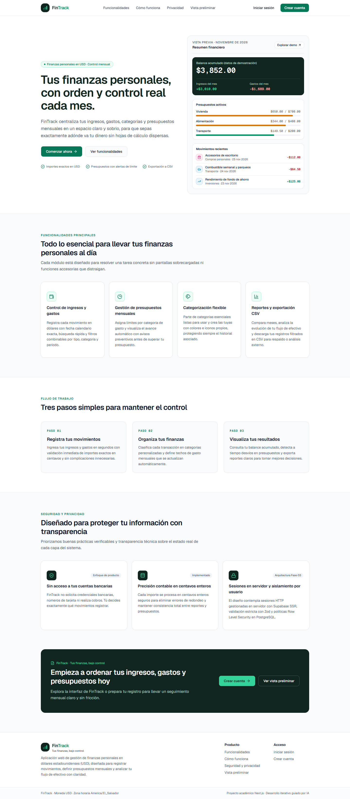 |
| Landing Page (Móvil) | `390x844` | 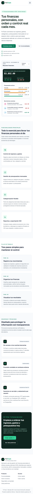 |
| Inicio de sesión | `1440x900` | 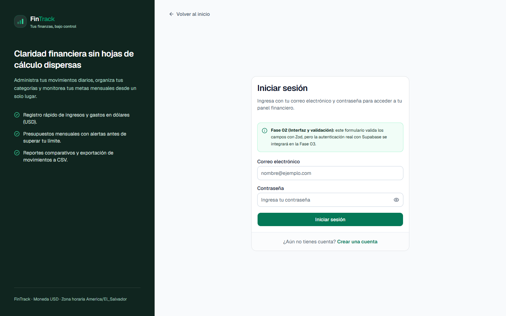 |
| Registro | `1440x900` | 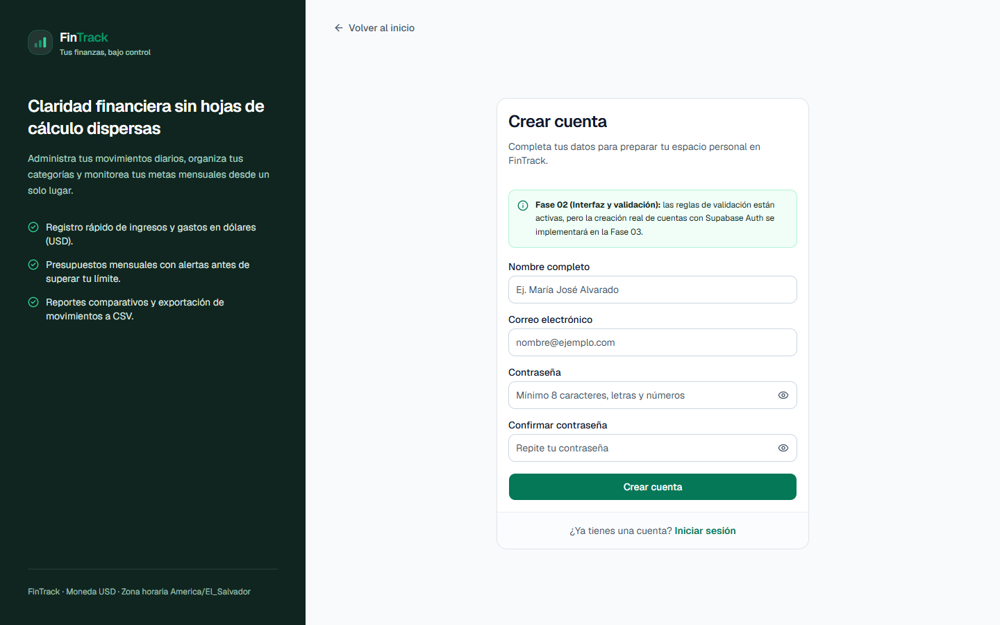 |
| Dashboard (Desktop) | `1440x900` | 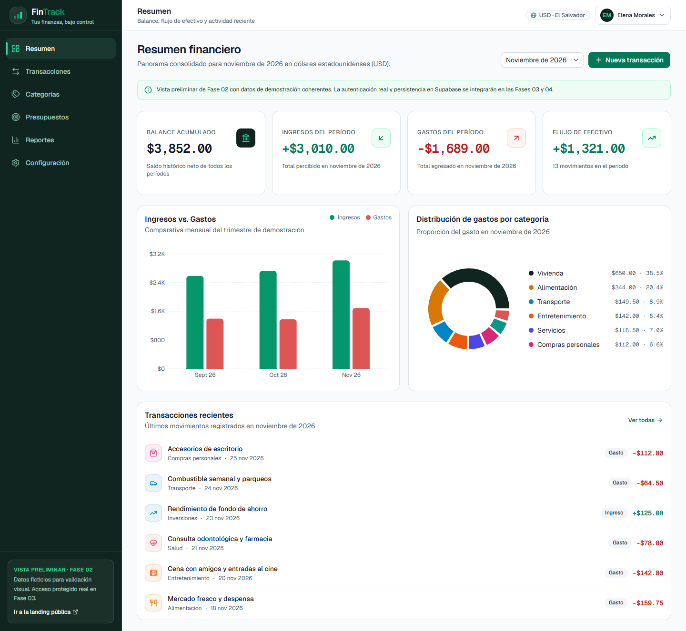 |
| Dashboard (Móvil) | `390x844` | 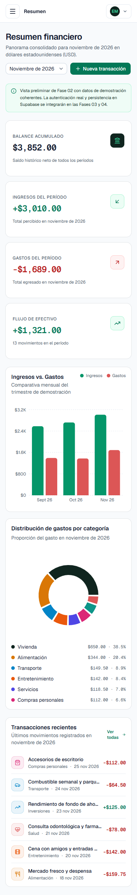 |
| Transacciones | `1440x900` | 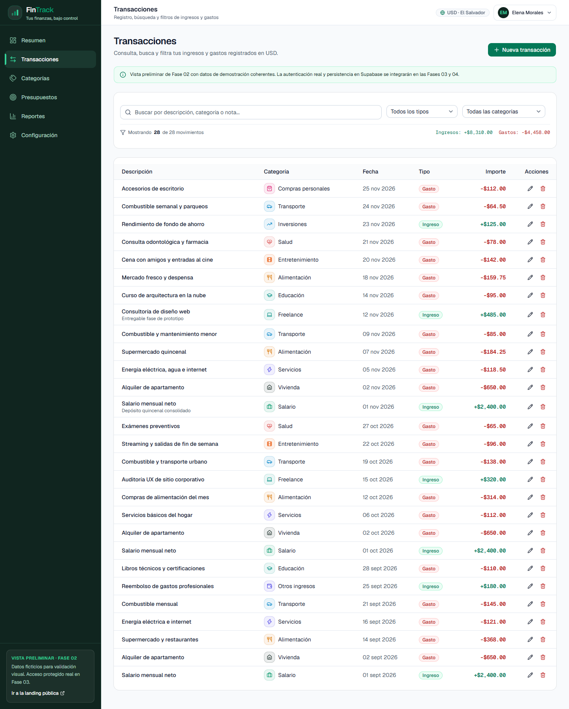 |
| Categorías | `1440x900` | 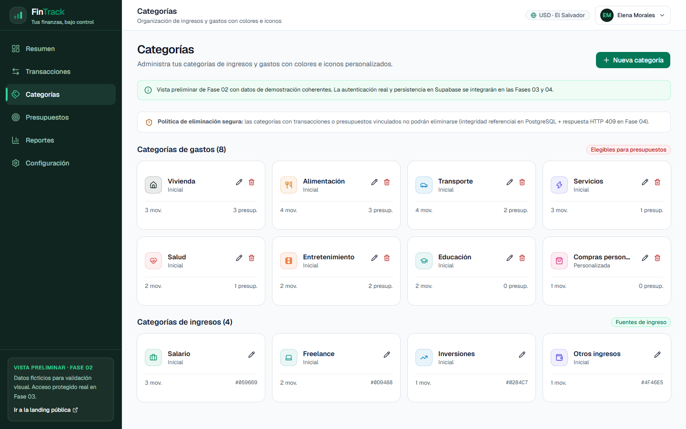 |
| Presupuestos | `1440x900` | 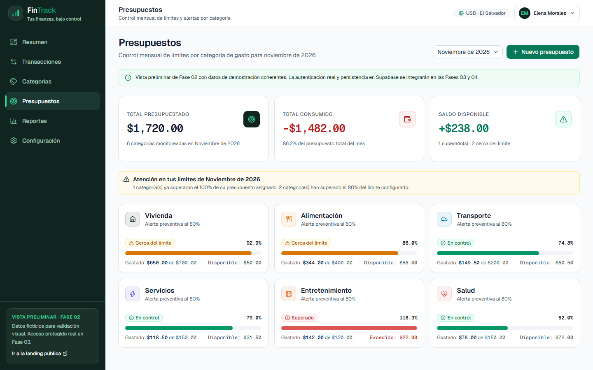 |
| Reportes | `1440x900` | 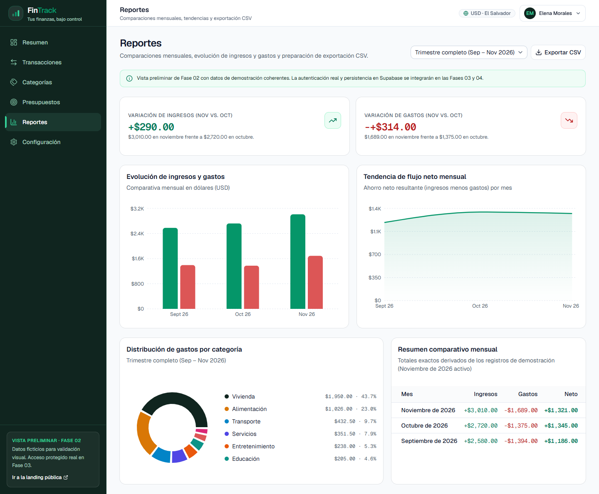 |
| Configuración | `1440x900` | 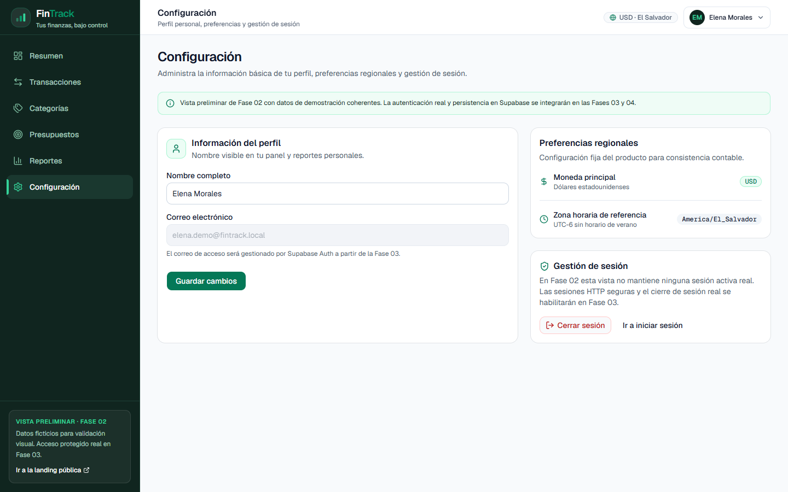 |

## 7. Referencias a Commits
- `2f33570` — `Initial commit from Create Next App`
- `cc46c23` — `chore: initialize FinTrack Next.js project`
- `a32798f` — `docs: establish architecture and vibe coding guidelines`
- `6ee5009` — `feat: implement FinTrack design system`
- `0e845b9` — `feat: build responsive marketing landing page`
- `81e3964` — `feat: create authentication interfaces`
- `63ef233` — `feat: implement responsive application shell`
- `404c4a8` — `feat: scaffold financial module interfaces`
- `10f5875` — `test: configure testing and validate initial application`
- `78c3aab` — `docs: document phase 02 implementation and validation`
- Commit de resolución visual de Fase 02 (`test: complete phase 02 browser and responsive validation`) y presente Walkthrough (`docs: add phase 02 implementation walkthrough`).

## 8. Limitaciones y Pendientes (Heredados a Fase 03+)
- Las vistas financieras de Fase 02 operan sobre datos ficticios (`src/lib/demo-data.ts`) sin protección de rutas ni base de datos real (resuelto en Fase 03 y Fase 04).

## 9. Instrucciones para Reproducir las Verificaciones
```bash
npm install
npm run lint
npm run typecheck
npm run test
npm run build
npm run verify:phase02
```
