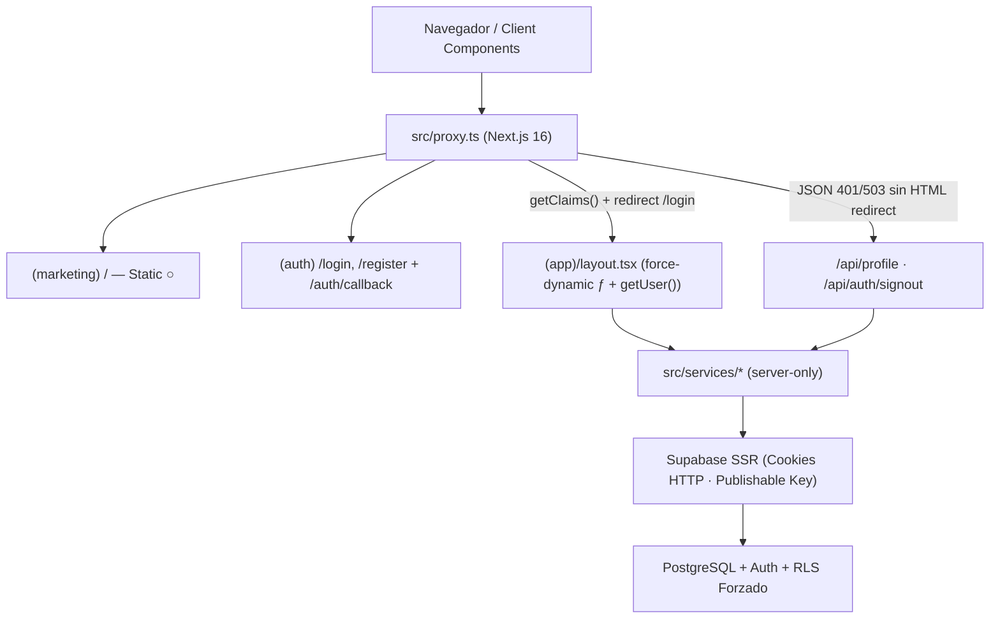
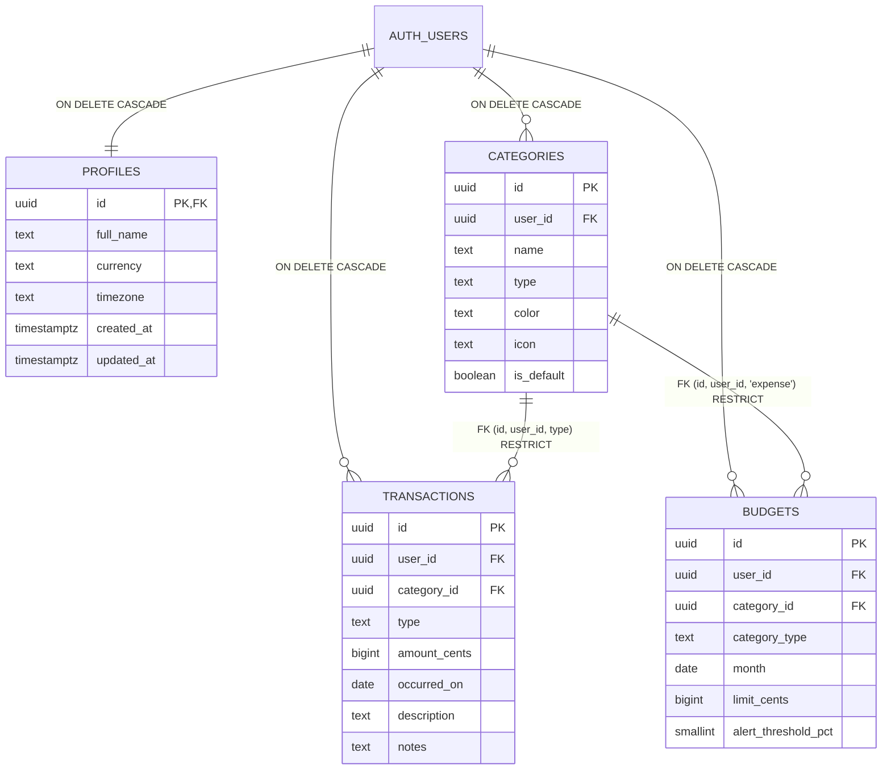
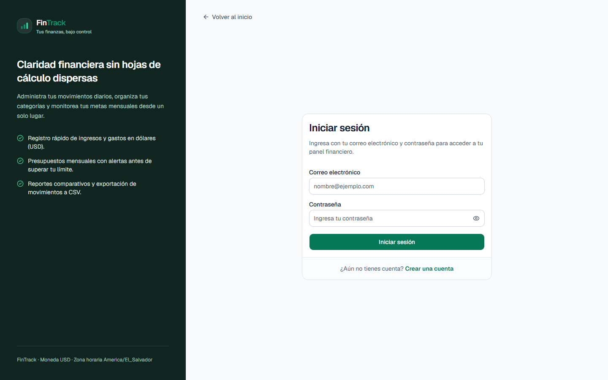
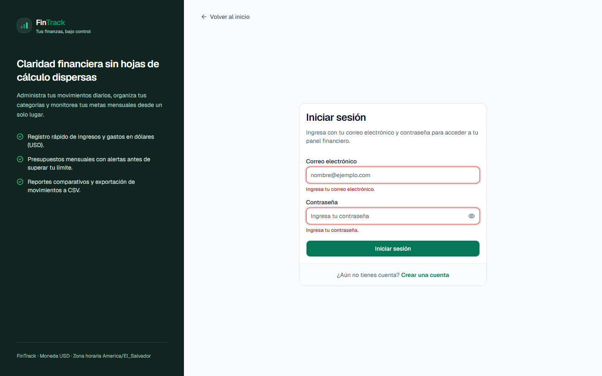
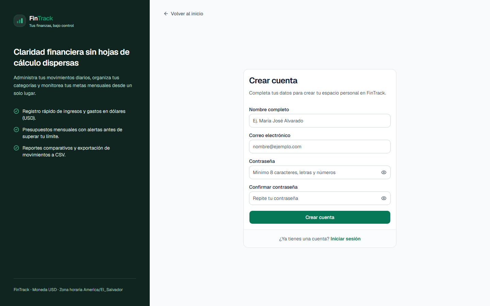
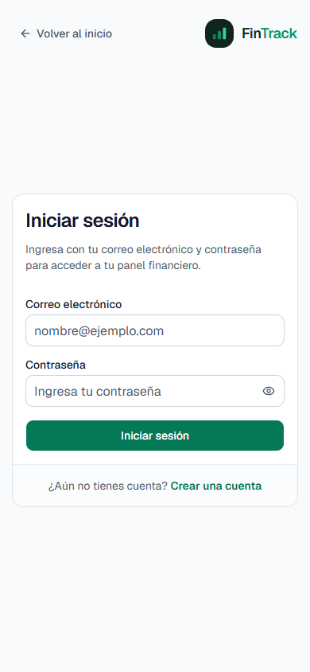

# Walkthrough — Fase 03: Base de Datos, Seguridad y Autenticación

> **Proyecto:** FinTrack (*Tus finanzas, bajo control*)  
> **Fase:** Fase 03 (incluyendo resolución completa de pendientes visuales de Fase 02)  
> **Actualización (2026-11-27):** La verificación real contra Supabase, las 18 pruebas RLS de 2 usuarios, las capturas autenticadas y la grabación WebM fueron completadas en [003.1-supabase-integration-validation.md](./003.1-supabase-integration-validation.md).  
> **Fecha:** 2026-11-26  
> **Prompts relacionados:** [001-master-planning.md](../prompts/001-master-planning.md) · [002-initialization-and-design.md](../prompts/002-initialization-and-design.md) · [003-database-and-authentication.md](../prompts/003-database-and-authentication.md)

---

## 1. Resumen Ejecutivo
Durante esta ejecución se completaron íntegramente los pendientes visuales de la Fase 02 mediante Playwright sobre Chromium aislado (verificando 9 rutas en 7 resoluciones, corrigiendo 2 desbordamientos reales y la jerarquía `<h1>`, y capturando las 11 evidencias PNG), se incorporó la regla permanente de Walkthroughs, se simplificó la configuración de caché de Next.js 16 para garantizar seguridad en rutas privadas, y se implementó la arquitectura completa de base de datos PostgreSQL + RLS + Supabase SSR + autenticación real + protección de rutas + APIs de perfil y cierre de sesión. Las pruebas locales (`lint`, `typecheck`, 22/22 tests Vitest, `build`, `npm audit` y `verify:phase03`) pasaron con `0` errores; únicamente queda pendiente la intervención humana para vincular un proyecto gratuito de Supabase en `.env.local`, aplicar el archivo SQL ya generado (`supabase/phase-03-setup.sql`) y correr la verificación remota de RLS (`npm run test:supabase-rls`).

## 2. Estado de la Fase 02 y Resolución de Pendientes
- **Estado de Fase 02:** **Completada y verificada al 100%.**
- **Solución aplicada al bloqueo de Chrome:** Se instaló `playwright@1.58.2` como `devDependency` con `scripts/run-with-server.mjs` y `scripts/verify-phase-02.mjs`, lanzando una instancia aislada sin modificar el perfil personal del usuario ni abrir puertos públicos.
- **Hallazgos corregidos antes de proteger rutas:**
  1. Desbordamiento en `/` a `768x1024` (`824px` vs `768px`) → ajustado breakpoint de `MarketingNavbar` de `md` a `lg`.
  2. Desbordamiento en `/` a `360x800` (`365px` vs `360px`) → `whitespace-normal` y `min-w-0` en el badge y columnas del hero.
  3. `h1Count: 0` en `/login` y `/register` → reemplazado `CardTitle` (`<div>`) por `<h1>`.
  4. Animación incompleta del gráfico circular al capturar → `isAnimationActive={false}` en `<Pie>`.
- **Walkthrough dedicado:** [002-initialization-and-design.md](./002-initialization-and-design.md) (incluye las 11 capturas reales `phase-02-*.png`).

## 3. Estado de la Fase 03
- **Código, migraciones SQL, políticas RLS, tipos, Supabase SSR, protección de rutas, APIs base, pruebas unitarias y verificación Playwright local:** **Implementado y Verificado**.
- **Aplicación remota en Supabase y pruebas en vivo con 2 usuarios reales (`npm run test:supabase-rls` + capturas autenticadas):** **Bloqueado (espera intervención humana para crear/conectar proyecto gratuito en Supabase)**.

## 4. Arquitectura Implementada



## 5. Diagrama Actualizado de Base de Datos



## 6. Migraciones y Restricciones de Integridad
- [20261126230000_initial_schema.sql](../../supabase/migrations/20261126230000_initial_schema.sql):
  - UUIDs con `gen_random_uuid()`, timestamps `created_at`/`updated_at` mantenidos por `public.set_updated_at()`.
  - `amount_cents` y `limit_cents` como `BIGINT` con `CHECK (> 0 AND <= 900000000000000)` coherente con `MAX_SAFE_CENTS` en JavaScript.
  - `UNIQUE (id, user_id, type)` en `categories` + `idx_categories_unique_name` sobre `(user_id, type, lower(btrim(name)))` + `CHECK` hexadecimal y catálogo de iconos Lucide.
  - `transactions`: FK compuesta `(category_id, user_id, type) REFERENCES categories (id, user_id, type) ON DELETE RESTRICT ON UPDATE RESTRICT` (garantiza propiedad, compatibilidad de tipo y bloqueo de borrado de categorías en uso).
  - `budgets`: columna generada `category_type text GENERATED ALWAYS AS ('expense') STORED` + FK compuesta `(category_id, user_id, category_type)` + `CHECK (EXTRACT(DAY FROM month) = 1)` + `UNIQUE (user_id, category_id, month)`.
  - 5 índices justificados para dashboard, filtros, tipo, categoría y presupuestos mensuales.
- [20261126230100_rls_and_seed.sql](../../supabase/migrations/20261126230100_rls_and_seed.sql) y consolidado listo para pegar [phase-03-setup.sql](../../supabase/phase-03-setup.sql):
  - Trigger `on_auth_user_created` → `public.handle_new_user()` (`SECURITY DEFINER`, `SET search_path = ''`, sin ejecución pública/anon/authenticated) que crea el perfil y las 12 categorías iniciales (4 ingresos: *Salario, Freelance, Inversiones, Otros ingresos*; 8 gastos: *Alimentación, Vivienda, Transporte, Servicios, Salud, Entretenimiento, Educación, Otros gastos*) sin transacciones ni presupuestos ficticios.

## 7. Políticas RLS y Mínimo Privilegio
- `REVOKE ALL ON TABLE public.profiles, public.categories, public.transactions, public.budgets FROM PUBLIC, anon;`.
- `GRANT SELECT, UPDATE (full_name)` en `profiles` y `GRANT SELECT, INSERT, UPDATE, DELETE` en `categories`, `transactions`, `budgets` solo a `authenticated`.
- `ENABLE ROW LEVEL SECURITY` y `FORCE ROW LEVEL SECURITY` en las 4 tablas.
- Políticas explícitas `SELECT`, `INSERT`, `UPDATE` (con `USING` y `WITH CHECK` impidiendo transferencia de propietario) y `DELETE` verificando `(SELECT auth.uid()) = user_id` (o `= id` en `profiles`). Sin políticas `USING (true)` y sin `service_role`.

## 8. Flujo de Autenticación y Protección de Rutas
1. **Registro (`/register`)**: Valida con Zod (`registerSchema`), ejecuta `supabase.auth.signUp` enviando `full_name` y `emailRedirectTo: "${origin}/auth/callback?next=/dashboard"`. Si la confirmación por correo está activa muestra pantalla de confirmación; si está desactivada entra a `/dashboard`.
2. **Callback (`/auth/callback`)**: Soporta `?code=...` (PKCE) y `?token_hash=...&type=...` (OTP), validando `?next=` mediante `sanitizeNextPath` para impedir open redirects.
3. **Inicio de sesión (`/login`)**: Valida con Zod (`loginSchema`), autentica con `signInWithPassword`, traduce errores sin enumerar cuentas y redirige al destino sanitizado.
4. **Protección en doble capa**: `src/proxy.ts` valida el JWT con `getClaims()` y refresca cookies HTTP; `src/app/(app)/layout.tsx` (`force-dynamic`) ejecuta `getAuthenticatedProfile()` usando `supabase.auth.getUser()` en servidor; las APIs (`/api/profile`, `/api/auth/signout`) validan `getUser()`, `isValidSameOrigin()` y responden JSON con `Cache-Control: no-store, private` (nunca redirecciones HTML).

## 9. Archivos Creados y Modificados
- **SQL:** `supabase/migrations/20261126230000_initial_schema.sql`, `supabase/migrations/20261126230100_rls_and_seed.sql`, `supabase/phase-03-setup.sql`.
- **Tipos y Supabase SSR:** `src/types/database.ts`, `src/lib/supabase/{env.ts, client.ts, server.ts, proxy.ts}`, `src/proxy.ts`.
- **Seguridad y APIs:** `src/lib/{redirects.ts, auth-errors.ts, api-response.ts}`, `src/schemas/profile.schema.ts`, `src/services/{profile.service.ts, categories.service.ts}`, `src/app/auth/callback/route.ts`, `src/app/api/auth/signout/route.ts`, `src/app/api/profile/route.ts`.
- **Vistas y layouts:** `next.config.ts`, `src/app/(auth)/{layout.tsx, login/page.tsx}`, `src/components/auth/{login-form.tsx, register-form.tsx}`, `src/app/(app)/{layout.tsx, dashboard/page.tsx, transactions/page.tsx, categories/page.tsx, budgets/page.tsx, reports/page.tsx, settings/page.tsx}`, `src/components/layout/{app-sidebar.tsx, app-header.tsx}`, `src/components/settings/settings-view.tsx`, `src/components/categories/categories-view.tsx` (y eliminación de las 4 vistas ficticias de Fase 02).
- **Pruebas y scripts:** `tests/security-helpers.test.ts`, `scripts/{run-with-server.mjs, verify-phase-02.mjs, verify-phase-03.mjs, test-supabase-rls.mjs}`.

## 10. Decisiones Técnicas
Ver ADRs completos en [ARCHITECTURE.md](../ARCHITECTURE.md) (`ADR-001` a `ADR-010`), destacando `ADR-009` (eliminación de `cacheComponents` y `partialPrefetching` + `force-dynamic` en `(app)/layout.tsx`) y `ADR-010` (defensa en profundidad + RLS forzado).

## 11–12. Problemas Encontrados y Soluciones Implementadas
1. **Conexión Chrome DevTools bloqueada (`DevToolsActivePort`):** Resuelto autónomamente con `playwright@1.58.2` sobre navegador aislado.
2. **Desbordamientos en `/` (`768x1024`, `360x800`) y `h1Count: 0` en auth:** Corregidos y re-verificados con `0` desbordamientos.
3. **Sobrescritura externa de `package.json`:** Detectada en logs de `npm`, restaurada desde `git show 10f5875:package.json` y verificada con `0 vulnerabilities`.
4. **Rutas `(app)/*` prerenderizadas como `○` sin `.env.local`:** Corregido con `export const dynamic = "force-dynamic"` en `(app)/layout.tsx` (ahora todas las rutas privadas compilan como `ƒ Dynamic`).
5. **Variable sin uso `userB` en script RLS:** Limpiada para `0` advertencias de ESLint.

## 13–14. Comandos Ejecutados y Resultados de Pruebas
- `npm run verify:phase02` → `EXIT=0` (9/9 rutas, 42/42 responsive sin overflow, 5/5 interactivos, 11 capturas, 0 errores consola/página).
- `npx next typegen` → `EXIT=0`.
- `npm run lint` → `EXIT=0` (0 errores, 0 advertencias).
- `npm run typecheck` → `EXIT=0`.
- `npm run test` → `EXIT=0` (**5 archivos, 22/22 tests aprobados**).
- `npm run build` → `EXIT=0` (compilado en `2.7s`, `/` estático `○`, 6 rutas privadas y 3 endpoints dinámicos `ƒ`, `Proxy` activo).
- `npm audit --audit-level=moderate` → `found 0 vulnerabilities` (622 paquetes).
- `npm run verify:phase03` → `EXIT=0` (6/6 rutas privadas redirigen a `/login`, `/api/profile` JSON + `no-store`, `/api/auth/signout` cross-origin `403`, open-redirect bloqueado, 4 capturas `phase-03-*.png`, 0 errores consola/página).

## 15. Verificación de Aislamiento entre Usuarios (RLS)
- **Políticas y script implementados (`Implementado`):** `supabase/migrations/20261126230100_rls_and_seed.sql` y suite ejecutable `npm run test:supabase-rls` (`scripts/test-supabase-rls.mjs`) que prueba visitante anónimo, Usuario A vs Usuario B (`SELECT`/`UPDATE`/`DELETE`/`INSERT` cruzados), trigger de perfil + 12 categorías, montos inválidos, tipo incompatible, presupuestos en ingresos, duplicados y borrado de categoría vinculada utilizando únicamente la Publishable Key.
- **Ejecución remota (`Bloqueado`):** Pendiente de creación del proyecto Supabase y configuración de `.env.local` por parte del usuario.

## 16. Evidencias Visuales Disponibles (Fase 03)
- Capturas reales verificadas y almacenadas en `docs/screenshots/`:
  - 
  - 
  - 
  - 
- **Pendientes hasta conectar Supabase real:** `phase-03-authenticated-dashboard.png`, `phase-03-empty-dashboard.png`, `phase-03-profile.png`, `phase-03-mobile-dashboard.png` y grabación del flujo autenticado completo.

## 17. Historial de Commits Reales (`main`)
- Fase 02 base: `2f33570`, `cc46c23`, `a32798f`, `6ee5009`, `0e845b9`, `81e3964`, `63ef233`, `404c4a8`, `10f5875`, `78c3aab`.
- Fase 03:
  - `b5c49f3` — `test: complete phase 02 browser and responsive validation`
  - `2092dc4` — `docs: add phase 02 implementation walkthrough`
  - `e85fe1e` — `refactor: simplify authenticated rendering configuration`
  - `cf5c08d` — `feat: add PostgreSQL database migrations`
  - `0ff33dd` — `feat: configure row level security policies`
  - `6d1ee68` — `feat: integrate Supabase SSR authentication`
  - `a71ae55` — `feat: implement user registration and login`
  - `4b5d1ce` — `feat: protect authenticated application routes`
  - `2880ce3` — `feat: integrate user profile and session management`
  - `b55a1d7` — `test: validate authentication and data isolation`
  - *(Seguido de `docs: document phase 03 implementation and walkthrough`)*

## 18. Estado de la Documentación
Actualizados y sincronizados: `AGENTS.md`, `.agents/rules/fintrack-standards.md`, `README.md`, `VIBE_CODING.md`, `docs/ARCHITECTURE.md`, `docs/IMPLEMENTATION_PLAN.md` (adenda Fase 03), `docs/TESTING.md`, `docs/prompts/README.md`, `docs/prompts/003-database-and-authentication.md`, `docs/walkthroughs/002-initialization-and-design.md` y `docs/walkthroughs/003-database-and-authentication.md`.

## 19. Matriz de Cumplimiento Académico

| Requisito obligatorio | Estado actual |
| :--- | :--- |
| Next.js 16+ estable + App Router (`src/proxy.ts`) | **Verificado** (`16.4.6`) |
| TypeScript estricto (`tsc --noEmit`) | **Verificado** |
| Mínimo 4 páginas/rutas distintas | **Verificado** (9 páginas + `/auth/callback` + 2 APIs) |
| Consumo de API mediante Route Handlers | **Implementado y Verificado** (`/api/profile`, `/api/auth/signout`; CRUD financiero en Fase 04) |
| Server Components + Client Components | **Verificado** |
| Uso funcional de `useState` y `useEffect` | **Implementado** (ampliación con filtros/fetch abortable en Fase 04) |
| Diseño responsive (7 resoluciones) | **Verificado** (42/42 sin overflow en Playwright) |
| Estados de carga y manejo de errores | **Verificado** |
| `.env.local` y `.env.example` documentado | **Implementado** (`.env.example` versionado; `.env.local` pendiente de valores Supabase del usuario) |
| Repositorio público en GitHub + historial iterativo | **Implementado localmente** (20+ commits reales; push en Fase 06) |
| `README.md` y `VIBE_CODING.md` + Walkthroughs | **Verificado** |
| Despliegue público en Vercel | **Pendiente** (Fase 06) |

## 20. Limitaciones, Bloqueos e Intervención Humana Requerida (Supabase)
Para completar la verificación remota de la Fase 03 (`npm run test:supabase-rls` y capturas autenticadas), se requieren **4 pasos sencillos del usuario** (0 costo, capa gratuita):
1. Crea un proyecto gratuito en [https://supabase.com](https://supabase.com).
2. En **Supabase Dashboard → SQL Editor → New query**, copia y pega el contenido completo de [`supabase/phase-03-setup.sql`](../../supabase/phase-03-setup.sql) y presiona **Run**.
3. En **Authentication → URL Configuration**, establece **Site URL** = `http://localhost:3000` y agrega `http://localhost:3000/auth/callback` en **Redirect URLs**.
4. En **Project Settings → API**, copia la **Project URL** y la **Publishable key** (nunca `service_role`) en un archivo nuevo `.env.local` en la raíz del proyecto (`.env.local`):
   ```env
   NEXT_PUBLIC_SUPABASE_URL=https://tu-proyecto.supabase.co
   NEXT_PUBLIC_SUPABASE_PUBLISHABLE_KEY=tu-publishable-key
   NEXT_PUBLIC_APP_URL=http://localhost:3000
   ```
   *(No pegues credenciales en el chat; guárdalas directamente en `.env.local` y avísame si deseas que ejecutemos `npm run test:supabase-rls` y capturemos el flujo autenticado antes de pasar a la Fase 04).*

## 21. Preparación para la Fase 04
Una vez conectado `.env.local` y validado `npm run test:supabase-rls`, el proyecto estará 100% listo para construir los servicios y Route Handlers de CRUD real (`/api/transactions`, `/api/categories`, `/api/budgets`, `/api/dashboard`, `/api/reports`, `/api/reports/export` en CSV sanitizado) sobre un esquema PostgreSQL ya endurecido con RLS e integridad referencial compuesta.

### Pasos de Reproducción Local
```bash
npm install
npm run lint
npm run typecheck
npm run test
npm run build
npm run verify:phase03
# Una vez configurado .env.local y aplicado supabase/phase-03-setup.sql:
npm run test:supabase-rls
```
