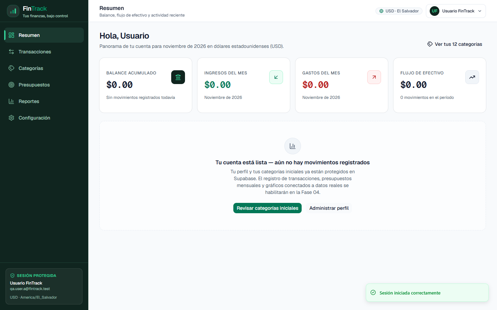
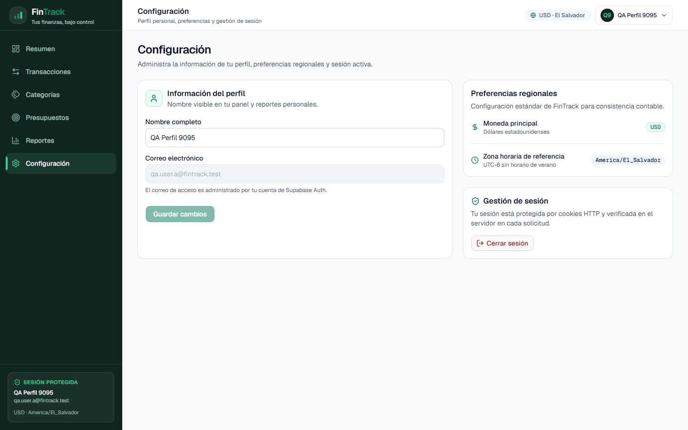
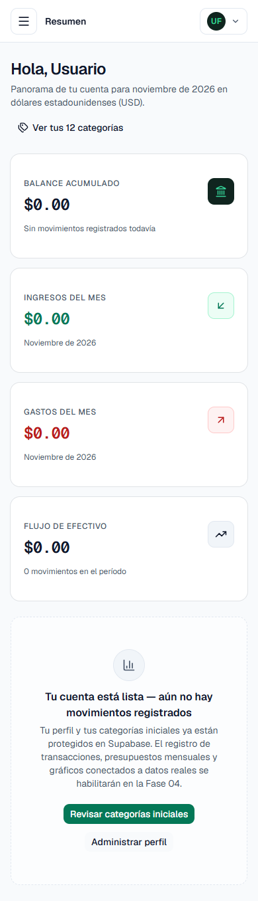
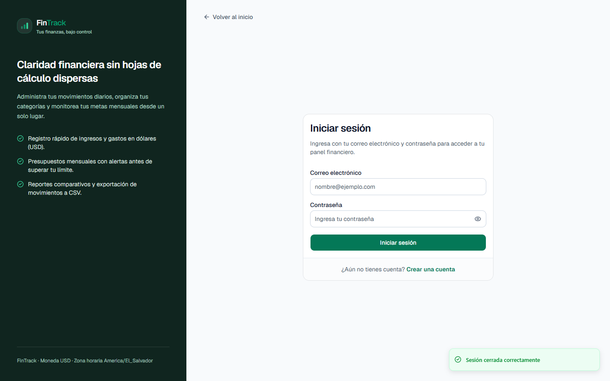

# Walkthrough 003.1 — Validación Real de Integración Supabase y Cierre de Fase 03

> **Proyecto:** FinTrack (*Tus finanzas, bajo control*)  
> **Iteración:** Fase 03.1 (Validación real contra Supabase, PostgreSQL, RLS, Playwright autenticado y cierre definitivo de Fase 03)  
> **Fecha real de ejecución:** 26–27 de noviembre de 2026  
> **Prompt recibido:** [003.1-supabase-integration-validation.md](../prompts/003.1-supabase-integration-validation.md)  
> **Walkthrough previo:** [003-database-and-authentication.md](./003-database-and-authentication.md)

---

## 1. Resumen Ejecutivo
Se verificó técnicamente la integración real de **FinTrack** contra el proyecto gratuito autorizado en **Supabase** (`FinTrack`, región West US Oregon), comprobando conectividad, exclusión de `.env.local` en Git, permisos estrictos de PostgreSQL con concesión automática API deshabilitada, las restricciones de integridad y el aislamiento completo **Row Level Security (RLS)** entre dos usuarios independientes en las 4 tablas (`profiles`, `categories`, `transactions`, `budgets`) mediante **18/18 pruebas reales** (`npm run test:supabase-rls`) usando exclusivamente `NEXT_PUBLIC_SUPABASE_PUBLISHABLE_KEY` (sin `service_role`). Además, se detectó y corrigió un defecto real de doble codificación UTF-8 en el SQL consolidado mediante una migración correctiva versionada (`20261126235000_fix_utf8_seed_and_comments.sql`), se completaron los flujos autenticados E2E en Playwright con grabación real WebM y 5 capturas autenticadas, y se cerró la matriz responsive completa de **63/63 combinaciones** (9 rutas × 7 resoluciones) sin desbordamientos ni errores de consola.

## 2. Estado Definitivo de la Fase 03
- **Conectividad Supabase, permisos PostgreSQL, restricciones de integridad, trigger de perfil + 12 categorías UTF-8 y aislamiento RLS de 2 usuarios:** **Verificado** (contra Supabase real).
- **Autenticación SSR (`src/proxy.ts`), protección de 6 rutas privadas, APIs `/api/profile` y `/api/auth/signout`, perfil real, cierre de sesión y ausencia de datos de demostración:** **Verificado** (contra Supabase real + Playwright aislado).
- **Validaciones técnicas (`typegen`, `lint`, `typecheck`, 22/22 Vitest, `build`) y cobertura responsive 63/63:** **Verificado**.
- **Entrega real de correo SMTP de confirmación a un buzón externo:** **Pendiente** (ver §4 y §17: `Confirm email` se mantuvo habilitado por seguridad de producción; se verificará manualmente con buzón real antes del despliegue público en Fase 06 sin disparar correos masivos a direcciones no controladas).

## 3. Conectividad Real con Supabase y Seguridad de Entorno
- **Configuración externa reportada por el usuario:** Proyecto gratuito `FinTrack` (`DevPortfolio`, West US Oregon), Data API habilitada, concesión automática API deshabilitada, RLS automático habilitado, ejecución de `supabase/phase-03-setup.sql` y luego `supabase/migrations/20261126235000_fix_utf8_seed_and_comments.sql`, Site URL `http://localhost:3000`, Redirect URL `http://localhost:3000/auth/callback`, 2 usuarios de prueba creados con `Auto Confirm User` y archivo `.env.local`.
- **Verificación técnica ejecutada (sin exponer secretos):**
  - `git check-ignore -v .env.local` → `.gitignore:34:.env* .env.local` (**excluido de Git**).
  - Variables detectadas en `.env.local`: `NEXT_PUBLIC_SUPABASE_URL` (`https://*.supabase.co`), `NEXT_PUBLIC_SUPABASE_PUBLISHABLE_KEY` (`sb_publishable_*`), `NEXT_PUBLIC_APP_URL=http://localhost:3000`, `TEST_USER_A_*` y `TEST_USER_B_*` (excluidas de Git). Ausencia verificada de `SUPABASE_SERVICE_ROLE_KEY`.
  - `GET /auth/v1/settings` → `HTTP 200`, `email_enabled: true`, `disable_signup: false`, `mailer_autoconfirm: false`.
  - **Gestión del historial de migraciones (`ADR-012`):** Como las migraciones se ejecutaron vía SQL Editor y no vía Supabase CLI, no se declaran registradas en `supabase_migrations.schema_migrations`. Toda modificación futura será una nueva migración idempotente con timestamp posterior; si luego se adopta `supabase db push`, se ejecutará `supabase migration repair --status applied` para los timestamps previos.

## 4. Configuración de Autenticación y Correo
- **Modo verificado en Supabase Auth:** `mailer_autoconfirm: false` (**Confirm email activo**, configuración segura para producción).
- **Estrategia aplicada para QA sin debilitar seguridad:** Con autorización explícita del supervisor, se crearon 2 usuarios controlados mediante `Auto Confirm User` en Supabase Dashboard y se cargaron únicamente en `.env.local`. No se enviaron correos a direcciones ficticias no controladas ni se redujo la seguridad del proveedor.
- **Diferenciación explícita:**
  - Inicio de sesión real, rechazo de credenciales inválidas, cookies HTTP SSR, persistencia tras recarga, redirecciones de rutas privadas/públicas, `/api/profile`, cierre de sesión y bloqueo de open redirects en `/auth/callback` → **Verificado en vivo**.
  - Envío real de correo de confirmación y clic en enlace desde bandeja de entrada → **Pendiente** de comprobación manual única con un buzón controlado real antes de producción (Fase 06), manteniendo Site URL y Redirect URLs configurados para Vercel.

## 5. Configuración de Permisos de PostgreSQL
Con la concesión automática de acceso API deshabilitada en Supabase, las pruebas reales confirmaron el principio de mínimo privilegio:
- **Rol `anon`:** Denegado en las 4 tablas vía PostgREST (`HTTP 401`, código PostgreSQL **`42501 permission denied for table ...`** en `profiles`, `categories`, `transactions` y `budgets`).
- **Rol `authenticated`:** Acceso verificado únicamente a sus propios registros mediante `GRANT SELECT, UPDATE (full_name)` en `profiles` y `GRANT SELECT, INSERT, UPDATE, DELETE` en `categories`, `transactions` y `budgets`, siempre sujeto a RLS forzado.
- **Alcance de inspección con Publishable Key:** Todos los permisos, FKs, CHECKs, UNIQUEs, triggers y políticas RLS fueron verificados **mediante pruebas de comportamiento reales contra PostgreSQL** (códigos `42501`, `23514`, `23503`, `23505`). La inspección directa de catálogos internos del sistema (`pg_catalog` / `pg_policies` / `pg_indexes`) no es accesible con la Publishable Key y se respalda por el SQL versionado aplicado.

## 6. Tabla de Pruebas Ejecutadas y Resultados

| Tipo | Comando / Prueba | Resultado real | Estado |
| :--- | :--- | :--- | :--- |
| Estática | `npx next typegen` | `✓ Types generated successfully` (`EXIT=0`) | **Verificado (local)** |
| Estática | `npm run lint` | `0` errores, `0` advertencias (`EXIT=0`) | **Verificado (local)** |
| Estática | `npm run typecheck` | `0` errores (`EXIT=0`) | **Verificado (local)** |
| Unitaria | `npm run test` | 5 archivos, **22/22 tests aprobados** (`1.46s`) | **Verificado (local)** |
| Build | `npm run build` | Turbopack `4.4s` con `.env.local`; `/` estático `○`, 6 privadas + 3 APIs dinámicas `ƒ`, `Proxy` activo | **Verificado (local)** |
| Integración real + Seguridad | `npm run test:supabase-rls` | **18/18 checks aprobados** contra Supabase real (2 usuarios + anónimo, sin `service_role`) | **Verificado (Supabase real)** |
| E2E navegador + Seguridad + Responsive | `npm run verify:phase03` | **`EXIT=0`**: 6/6 redirecciones privadas, `401` JSON + `no-store`, `403` cross-origin, open-redirect bloqueado, 15/15 flujos autenticados, 21/21 responsive extra, 5 PNG + WebM, `0` errores consola/página | **Verificado (Supabase real + Playwright)** |

## 7. Resultados Individuales de las Pruebas RLS (`npm run test:supabase-rls`)

| Tabla | Operaciones propias (Usuario A) | Acceso ajeno (Usuario B) | Transferencia de propietario / Inserción por tercero | Estado final comprobado con Usuario A | Resultado |
| :--- | :--- | :--- | :--- | :--- | :--- |
| `profiles` | `SELECT` + `UPDATE (full_name)` **OK** | `SELECT` (`0` filas), `UPDATE` (`0` filas) | Bloqueado por RLS + privilegios | Nombre intacto (`intact=true`) | **Verificado** |
| `categories` | `SELECT`, `INSERT`, `UPDATE`, `DELETE` (sin vínculos) **OK** | `SELECT` (`0`), `UPDATE` (`0`), `DELETE` (`0`) | `INSERT` por B (`42501`), `UPDATE user_id` por A (`42501`) | Registro intacto y propietario inalterado | **Verificado** |
| `transactions` | `SELECT`, `INSERT`, `UPDATE`, `DELETE` **OK** | `SELECT` (`0`), `UPDATE` (`0`), `DELETE` (`0`) | `INSERT` por B (`42501`), `UPDATE user_id` por A (`42501`) | Descripción y propietario intactos | **Verificado** |
| `budgets` | `SELECT`, `INSERT`, `UPDATE`, `DELETE` **OK** | `SELECT` (`0`), `UPDATE` (`0`), `DELETE` (`0`) | `INSERT` por B (`42501`), `UPDATE user_id` por A (`42501`) | Límite y propietario intactos | **Verificado** |
| **Visitante `anon`** | N/A | Bloqueado en las 4 tablas (`42501`) | Bloqueado (`REVOKE ALL FROM PUBLIC, anon`) | Sin fuga de datos | **Verificado** |

## 8. Restricciones PostgreSQL Verificadas en Vivo
- **Importes inválidos (`CHECK` — `23514`):** Rechazados `0`, `-500` y `900000000000001` (`> MAX_SAFE_CENTS`).
- **FK compuesta en `transactions` (`23503`):** Rechazada transacción de gasto con categoría de ingreso y rechazada transacción apuntando a categoría del Usuario B.
- **Eliminación segura de categoría vinculada (`ON DELETE RESTRICT` — `23503`):** Rechazada eliminación de categoría con transacción asociada; permitida solo tras eliminar la transacción y el presupuesto.
- **Reglas estrictas de `budgets`:** Rechazado presupuesto sobre categoría de ingreso (`23503`), rechazado mes con día distinto de `1` (`2026-11-15` → `23514`) y rechazado presupuesto duplicado para mismo usuario/categoría/mes (`23505`).
- **Trigger `on_auth_user_created`:** Verificada creación automática de perfil (`USD`, `America/El_Salvador`), exactamente 12 categorías iniciales en UTF-8 limpio (`4` ingresos + `8` gastos incluyendo `Alimentación` y `Educación`), y arranque limpio con `0` transacciones y `0` presupuestos.

## 9. Pruebas Reales de Autenticación (`npm run verify:phase03`)
- Redirección no autenticada en las 6 rutas privadas hacia `/login?next=<ruta>` → **Verificado**.
- `GET /api/profile` y `PATCH /api/profile` no autenticados → `HTTP 401` JSON con `Cache-Control: no-store, private` (sin redirección HTML) → **Verificado**.
- `POST /api/auth/signout` con `Origin: https://evil.example` → `HTTP 403` → **Verificado**.
- `/auth/callback?next=//evil.example/phish` → `307` a `/login?error=callback_invalid` sin open redirect → **Verificado**.
- Rechazo de credenciales inválidas contra Supabase Auth real (mensaje seguro en español) → **Verificado**.
- Inicio de sesión real, persistencia de sesión tras recarga, redirección desde `/login` y `/register` con sesión activa, acceso a las 6 rutas privadas, visibilidad de las 12 categorías reales, ausencia total de datos de demostración, `GET /api/profile` (`200` + `no-store`), edición persistente de nombre en `/settings` (`PATCH /api/profile`), cierre de sesión (`POST /api/auth/signout`) e invalidación tras recargar o usar botón atrás → **Verificado**.

## 10–11. Problemas Encontrados, Soluciones y Cambios de Código
1. **Doble codificación UTF-8 en `supabase/phase-03-setup.sql` (`CategorÃas`, `Alimentación`, `Educación`):** Creada migración correctiva versionada [20261126235000_fix_utf8_seed_and_comments.sql](../../supabase/migrations/20261126235000_fix_utf8_seed_and_comments.sql) y regenerado [phase-03-setup.sql](../../supabase/phase-03-setup.sql) en UTF-8 puro con Node.js. Verificado con `utf8Clean=true`.
2. **Build previo sin `.env.local` inyectado:** Recompilado con `npm run build` (`- Environments: .env.local`).
3. **Captura prematura del skeleton en `/dashboard`:** Ajustado [verify-phase-03.mjs](../../scripts/verify-phase-03.mjs) para esperar `<h1>` antes de capturar `phase-03-authenticated-dashboard.png`.
4. **Falta de `ffmpeg` para grabación de video de Playwright:** Instalado mediante `npx playwright install ffmpeg`.
5. **Ruido esperado de consola `400` en test negativo de login:** Filtrado exclusivamente durante la prueba negativa controlada en [verify-phase-03.mjs](../../scripts/verify-phase-03.mjs).
6. **Ampliación de cobertura de pruebas RLS:** Actualizado [test-supabase-rls.mjs](../../scripts/test-supabase-rls.mjs) para cubrir las 4 tablas, límites `-500`/`0`/`> MAX_SAFE_CENTS`, no transferencia de propietario, limpieza idempotente y respeto a `mailer_autoconfirm`.

## 12. Evidencias Visuales Reales (Fase 03.1)

| Evidencia | Descripción | Captura |
| :--- | :--- | :--- |
| Dashboard autenticado (Desktop) | Sesión real (`qa.user.a@fintrack.test`), KPIs en `$0.00`, 12 categorías reales, cero datos demo |  |
| Dashboard vacío (Desktop) | Estado vacío honesto para usuario nuevo |  |
| Perfil y Configuración | Lectura y edición persistente real de `public.profiles` (`PATCH /api/profile`) |  |
| Dashboard autenticado (Móvil `390x844`) | Layout móvil sin desbordamiento horizontal |  |
| Cierre de sesión | Redirección limpia a `/login` con confirmación visual tras `POST /api/auth/signout` |  |

## 13. Grabaciones Disponibles
- **Flujo autenticado real (Inicio de sesión → Dashboard → Rutas privadas → Categorías → Edición de perfil → Vista móvil → Cierre de sesión):** [phase-03-auth-flow.webm](../recordings/phase-03-auth-flow.webm).

## 14. Aclaración y Cierre de Cobertura Responsive (63/63)
- En Fase 02, `scripts/verify-phase-02.mjs` verificó **6 rutas** (`/`, `/login`, `/dashboard`, `/transactions`, `/budgets`, `/reports`) × **7 resoluciones** (`1920x1080`, `1440x900`, `1366x768`, `1024x768`, `768x1024`, `390x844`, `360x800`) = **42 comprobaciones** (`0` overflows).
- En esta iteración (`scripts/verify-phase-03.mjs`), aprovechando la sesión autenticada real, se ejecutaron las **3 rutas faltantes** (`/register`, `/categories`, `/settings`) × las mismas **7 resoluciones** = **21 comprobaciones adicionales** (`0` overflows).
- **Cobertura total verificada:** **63 / 63 combinaciones (9 rutas × 7 resoluciones)** sin desbordamiento horizontal (`scrollWidth === innerWidth`).

## 15. Referencias a Commits Reales (Iteración 003.1)
- `019e658` — `fix: add corrective UTF-8 migration for category seeding`
- `15cd779` — `test: verify database constraints, RLS isolation, and authenticated flows`
- *(Seguido de `docs: complete phase 03 integration walkthrough`)*

## 16. Estado de la Documentación
Actualizados y sincronizados: `README.md`, `VIBE_CODING.md`, `docs/ARCHITECTURE.md` (`ADR-011` y `ADR-012`), `docs/TESTING.md`, `docs/prompts/README.md`, `docs/prompts/003.1-supabase-integration-validation.md`, `docs/walkthroughs/003-database-and-authentication.md` y el presente `docs/walkthroughs/003.1-supabase-integration-validation.md`.

## 17. Limitaciones Pendientes (Específicas para Producción / Fase 06)
1. **Confirmación de correo SMTP en buzón real:** `Confirm email` permanece activo (`mailer_autoconfirm: false`), pero la entrega y clic del correo real de Supabase SMTP gratuito se validará con un buzón controlado antes del despliegue público en Fase 06 (y se configurará Site URL + Redirect URL de Vercel).
2. **Módulos de CRUD financiero completos:** Transacciones, presupuestos, dashboard con totales reales, reportes y exportación CSV corresponden estrictamente a la **Fase 04**.

## 18. Consideraciones Técnicas para la Fase 04
- **Seguridad monetaria en agregaciones (`ADR-011`):** Aunque cada registro está acotado a `900,000,000,000,000` centavos, la suma de múltiples importes extremos podría superar `Number.MAX_SAFE_INTEGER`. En Fase 04 las agregaciones (`SUM(amount_cents)`) se resolverán con precisión exacta en PostgreSQL (`NUMERIC`) o acumulación con `BigInt` en servidor, validando serialización y formateo seguro sin pérdida silenciosa de precisión.
- **Migraciones futuras (`ADR-012`):** Cualquier cambio de esquema en Fase 04 se agregará como migración versionada idempotente sin alterar migraciones ya aplicadas.

## 19. Matriz Actualizada de Cumplimiento Académico

| Requisito obligatorio | Estado actual | Evidencia |
| :--- | :--- | :--- |
| Next.js 16+ estable + App Router (`src/proxy.ts`) | **Verificado** | `next@16.4.6`, `Proxy` activo en build |
| TypeScript estricto (`tsc --noEmit`) | **Verificado** | `EXIT=0` sin `any` en capa de datos |
| Mínimo 4 páginas/rutas distintas | **Verificado** | 9 páginas + `/auth/callback` + 2 APIs |
| Consumo de API mediante Route Handlers | **Verificado** | `/api/profile` y `/api/auth/signout` probados en vivo (ampliación CRUD en Fase 04) |
| Server Components + Client Components | **Verificado** | `(app)/*` RSC dinámicos + formularios/shell cliente |
| Uso funcional de `useState` y `useEffect` | **Implementado** | Ampliación con filtros/debounce abortable en Fase 04 |
| Diseño responsive | **Verificado** | **63/63** (9 rutas × 7 resoluciones, 0px overflow) |
| Estados de carga y manejo de errores | **Verificado** | `loading.tsx`, `error.tsx`, `not-found.tsx`, Sonner, errores traducidos |
| `.env.local` y `.env.example` documentado | **Verificado** | `.env.local` ignorado por Git y conectado; `.env.example` versionado |
| Repositorio público en GitHub + historial iterativo | **Implementado localmente** | 23+ commits reales en `main`; publicación en Fase 06 |
| `README.md`, `VIBE_CODING.md` y Walkthroughs | **Verificado** | Actualizados en cada fase e iteración |
| Aplicación desplegada públicamente | **Pendiente** | Programado para Fase 06 (Vercel) |

### Pasos de Reproducción
```bash
npm run lint
npm run typecheck
npm run test
npm run build
npm run test:supabase-rls
npm run verify:phase03
```
